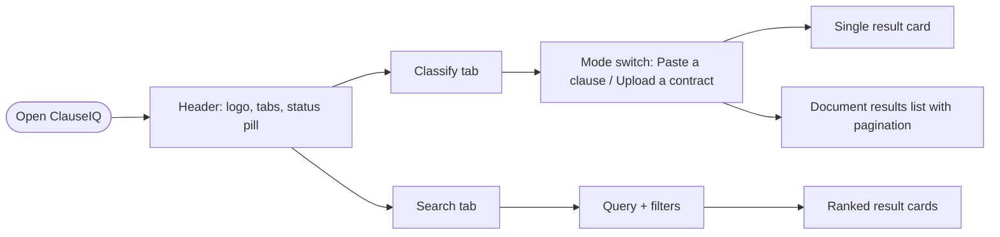

# ClauseIQ – UI/UX Design Document

**Product:** ClauseIQ – Machine Learning-Based Contract Clause Classification and Intelligent Search System
**Document:** Visual and interaction design specification, version 1.0
**Scope:** Front-end design for the existing React 18 + Vite application (plain CSS, native `fetch`)
**Design goal:** Make a dense, serious subject (legal contracts) feel calm, clear, and quietly premium, while staying honest about what a machine-learning model can and cannot tell the user.

> **Scope note.** This document designs the screens ClauseIQ already has (Classify, Search, status indicator) and refines how they look and feel. Anything that needs new backend capability (export, history, dashboards, saved-contract views) is marked **Future** and is not part of the current design. No new frameworks are required: everything here is achievable with the existing CSS file, React components, and a few inline SVG icons.

---

## 1. Design Vision

| | |
|---|---|
| **Personality** | Calm, precise, trustworthy, modern |
| **Feels like** | A well-lit reading room for contracts, not a flashy dashboard |
| **Tagline (UI copy)** | *Find the clause that matters.* |
| **Emotional goals** | Confidence (it looks professional), clarity (I know what I am looking at), control (I can verify the result) |
| **Not** | Loud, gamified, or "magic AI" styling. The product must never look more certain than the model is |

### 1.1 Design Principles

1. **Clause text is the hero.** Labels, scores, and badges support the original wording and never bury it.
2. **Honest confidence.** Scores are always shown with their plain-language status and a one-line reminder that they are estimates. No celebratory effects on low-confidence results.
3. **Calm density.** Generous whitespace around dense content; one primary action per view.
4. **Progressive disclosure.** Show the top answer first; alternatives and details expand on demand.
5. **Never color alone.** Every status uses color plus an icon plus a word.
6. **Fast feedback.** Every action acknowledges itself within 100 ms (pressed state, spinner, skeleton).

---

## 2. Brand Identity

### 2.1 Logo and wordmark

- **Mark:** a rounded-square "document" glyph with a folded corner and a highlighted line (a clause being picked out), in a blue-to-indigo gradient tile.
- **Wordmark:** `Clause` in semi-bold ink, `IQ` in the brand gradient. Letter-spacing −0.01em.
- **Clear space:** one "I" stem width on all sides. **Minimum size:** 24 px tile.
- **Favicon:** the tile only (the project already embeds an inline SVG favicon, which can be recolored to the gradient).

### 2.2 Voice

Plain, professional, reassuring. Short sentences, active verbs, no jargon in the UI ("Check a clause", not "Run inference").

---

## 3. Color System

The current app uses a clean blue-on-slate light theme. This design **keeps that foundation** and extends it with a gradient accent, a refined neutral scale, and a full dark theme.

### 3.1 Brand and neutrals (light theme)

| Token | Hex | Use |
|---|---|---|
| `--bg-page` | `#F6F8FC` | Page background (slightly cooler than the current `#F8FAFC`) |
| `--bg-card` | `#FFFFFF` | Cards, inputs |
| `--bg-surface` | `#EEF2F9` | Wells, segmented control track, code/clause backgrounds |
| `--border-color` | `#E2E8F0` | Hairlines |
| `--border-hover` | `#CBD5E1` | Hover borders |
| `--text-primary` | `#0F172A` | Headings, clause text |
| `--text-secondary` | `#475569` | Body, labels |
| `--text-muted` | `#94A3B8` | Hints, placeholders (not for essential info) |
| `--primary` | `#2563EB` | Primary actions, links, focus ring |
| `--primary-hover` | `#1D4ED8` | Hover and pressed |
| `--primary-light` | `#EFF6FF` | Tinted backgrounds |
| `--accent` | `#6366F1` | Indigo, used only in the brand gradient and the search view highlights |

**Brand gradient:** `linear-gradient(135deg, #2563EB 0%, #6366F1 100%)` – logo tile, primary button on hover, hero accents, progress fill.
**Page atmosphere:** a very soft radial wash behind the hero (`radial-gradient(900px 400px at 50% -10%, rgba(99,102,241,.10), transparent)`), no images.

### 3.2 Semantic colors

| Meaning | Text | Background | Border | Icon |
|---|---|---|---|---|
| Success / High confidence | `#15803D` | `#F0FDF4` | `#BBF7D0` | check-circle |
| Moderate | `#1D4ED8` | `#EFF6FF` | `#BFDBFE` | gauge |
| Warning / Low – review required | `#B45309` | `#FFFBEB` | `#FDE68A` | eye |
| Error | `#B91C1C` | `#FEF2F2` | `#FECACA` | alert-circle |
| Neutral / Out of scope | `#475569` | `#F1F5F9` | `#E2E8F0` | help-circle |

### 3.3 Dark theme

Applied with `@media (prefers-color-scheme: dark)` and an optional manual toggle in the header.

| Token | Hex |
|---|---|
| `--bg-page` | `#0B1020` |
| `--bg-card` | `#121A2E` |
| `--bg-surface` | `#182340` |
| `--border-color` | `#243252` |
| `--text-primary` | `#E8EDF7` |
| `--text-secondary` | `#A5B1C8` |
| `--primary` | `#6EA0FF` |
| `--accent` | `#8B8DF6` |

Semantic backgrounds become 12% tints of the semantic color over the card color, with the same icons and words.

### 3.4 Category tag colors

ClauseIQ has 41 categories, so each category gets a **deterministic color from an 8-hue palette** (computed from the category name, so a category always has the same color). This avoids hand-assigning 41 colors and avoids implying groupings the model does not have.

| Slot | Tag background | Tag text |
|---|---|---|
| 1 | `#E0ECFF` | `#1E40AF` |
| 2 | `#E7E5FF` | `#4338CA` |
| 3 | `#DFF6F0` | `#0F766E` |
| 4 | `#FDEBD3` | `#9A3412` |
| 5 | `#FCE4EC` | `#9D174D` |
| 6 | `#EAF5D3` | `#3F6212` |
| 7 | `#E6EEF5` | `#334155` |
| 8 | `#F3E8FF` | `#6B21A8` |

All pairs meet WCAG AA contrast (4.5:1) for 13 px semibold text.

---

## 4. Typography

| Role | Font | Size / line | Weight | Notes |
|---|---|---|---|---|
| Display (hero title) | Inter | 36 / 44 px | 700 | `-0.02em`, clamp to 28 px on mobile |
| H1 (page title) | Inter | 28 / 36 | 700 | |
| H2 (card title) | Inter | 20 / 28 | 600 | |
| H3 (section label) | Inter | 15 / 22 | 600 | |
| Body | Inter | 15 / 24 | 400 | |
| Small / label | Inter | 13 / 20 | 500 | Uppercase labels use `0.06em` tracking, 12 px |
| **Clause text** | **Source-serif style stack** `Georgia, 'Times New Roman', serif` | 16 / 28 | 400 | Gives contract text a "document" feel and separates it from UI text |
| Numbers / scores | JetBrains Mono | 14 / 20 | 500 | `font-variant-numeric: tabular-nums` |

Inter and JetBrains Mono are already loaded by `index.html`. The serif stack is a system fallback (no extra font download). Max line length for clause text: 72 characters.

---

## 5. Layout, Spacing, Shape, Depth

| System | Spec |
|---|---|
| Grid | 12 columns, max content width 1040 px, page gutter 24 px (16 px under 640 px) |
| Spacing scale | 4, 8, 12, 16, 24, 32, 48, 64 px |
| Radius | 8 px inputs and chips, 12 px buttons and small cards, 16 px main cards, 999 px badges and pills |
| Borders | 1 px `--border-color`; focus ring 3 px `rgba(37,99,235,.35)` plus a 1 px primary border |
| Shadows | `xs` resting hairline, `md` cards, `lg` popovers; hover raises a card by 2 px with `lg` |
| Glass | Sticky header uses `backdrop-filter: blur(12px)` with 85% card color |

---

## 6. Iconography

Inline SVG, 1.75 px stroke, rounded caps and joins, 20 px default (the app already uses this style). Icon set: `file-text`, `upload-cloud`, `search`, `sparkles` (not used for AI claims; used only on the primary "Analyze" button), `check-circle`, `gauge`, `eye`, `alert-circle`, `help-circle`, `chevron-down`, `copy`, `x`, `sun`, `moon`. Decorative icons get `aria-hidden="true"`.

---

## 7. Information Architecture



Two top-level tabs (as built): **Classify** and **Search**. No account area, no settings page (no authentication exists).

---

## 8. Screen Designs

### 8.1 Global shell

**Header (sticky, 64 px):**

```
┌──────────────────────────────────────────────────────────────────────────┐
│ [▣ ClauseIQ]        ( Classify | Search )                ● System Ready  ☾ │
└──────────────────────────────────────────────────────────────────────────┘
```

- Logo tile with gradient; tabs in a pill-shaped segmented control with a sliding active indicator (200 ms).
- **Status pill** reflects `/health`: green dot "System Ready", amber pulsing dot "System Initializing", gray dot "System Offline". Tooltip lists model, search engine, and database status.
- Theme toggle (sun/moon) at the far right (optional).

**Footer:** one line: "ClauseIQ is a research tool and does not provide legal advice." plus project/college credit.

### 8.2 Classify tab – Paste a clause

```
                 Find the clause that matters.
     Classify contract clauses into 41 legal categories in seconds.

   ┌ ( Paste a clause )( Upload a contract ) ───────────────────────────────┐
   │  Clause text                                                           │
   │ ┌────────────────────────────────────────────────────────────────────┐ │
   │ │ Paste a contract clause here…                                       │ │
   │ │                                                                     │ │
   │ └────────────────────────────────────────────────────────────────────┘ │
   │  Try an example:  [Governing law] [Confidentiality] [Termination]      │
   │                                              [ ✦ Classify clause ]     │
   └────────────────────────────────────────────────────────────────────────┘
```

- Card is white, 16 px radius, `md` shadow; textarea has a serif font at 16 px so pasted legal text looks like a document.
- Example chips fill the textarea (the app already has sample clauses).
- Character counter at the bottom-right of the textarea.
- Primary button shows a spinner and the label "Classifying…" while loading; disabled when empty.

**Single-result card** (slides up 12 px and fades in over 250 ms):

```
┌───────────────────────────────────────────────────────────────────────────┐
│ RESULT                                             ( ● High confidence )  │
│                                                                           │
│  “This Agreement shall be governed by the laws of the State of Delaware.” │
│                                                                           │
│  Predicted category                    Confidence                         │
│  ┌──────────────────┐                  ◔ 87.4 %    ▰▰▰▰▰▰▰▰▱▱            │
│  │ Governing Law    │                  Estimate from the model – not a    │
│  └──────────────────┘                  guarantee of correctness.          │
│                                                                           │
│  Other possibilities                                           [ Show ⌄ ] │
│   2  Cap On Liability          6.1 % ▰▱▱▱▱▱▱▱▱▱                           │
│   3  Anti-Assignment           2.3 % ▱▱▱▱▱▱▱▱▱▱                           │
│   4  Audit Rights              1.0 % ▱▱▱▱▱▱▱▱▱▱                           │
│                                                                           │
│  [ Copy category ]   ⓘ A person should verify this label.                 │
└───────────────────────────────────────────────────────────────────────────┘
```

*(Numbers above are illustrative placeholders for layout, not real model output.)*

- **Confidence gauge:** a 72 px ring (SVG circle with `stroke-dasharray`) with the percentage in the center in JetBrains Mono. Ring color follows the semantic color of the status. Below it, the status badge and the one-line honesty note.
- **Category tag:** large (18 px semibold) pill using the category's deterministic color.
- **Alternatives** are collapsed by default; expanded shows horizontal bars scaled to the alternative's own score (not to the top score, to avoid exaggeration).
- The original clause is shown at the top in serif so the user can verify the label against the wording.

### 8.3 Classify tab – Upload a contract

```
   ┌────────────────────────────────────────────────────────────────────────┐
   │        ┌ ─ ─ ─ ─ ─ ─ ─ ─ ─ ─ ─ ─ ─ ─ ─ ─ ─ ─ ─ ─ ─ ─ ─ ┐                │
   │             ☁↑   Drop your contract here                                │
   │             or  [ Browse files ]    PDF or TXT · text-based PDFs only   │
   │        └ ─ ─ ─ ─ ─ ─ ─ ─ ─ ─ ─ ─ ─ ─ ─ ─ ─ ─ ─ ─ ─ ─ ─ ┘                │
   │                                                                         │
   │   (after selecting)  ▤ service_agreement.pdf   284 KB      [ ✕ Remove ] │
   │                                           [ ✦ Extract & classify ]      │
   └────────────────────────────────────────────────────────────────────────┘
```

- Dropzone: dashed 2 px border in `--primary-border`; on drag-over it fills with `--primary-light`, the border turns solid primary, and the icon bounces 4 px.
- Helper text says scanned image-only PDFs are not supported (matches the backend, which has no OCR).
- Wrong file type: inline error under the dropzone with the alert icon, not a toast: "Please choose a PDF (.pdf) or text (.txt) file."

**Processing state:** the card shows a three-step progress strip (*Reading file → Finding clauses → Classifying*). The backend returns a single response, so the steps are a **time-based visual** only (they advance on a timer and complete when the response arrives). The copy should say "Processing your document…" and avoid claiming precise progress.

**Document results:**

```
 service_agreement.pdf                         24 clauses found
 [ Filter by category ⌄ ]   [ Sort: Document order ⌄ ]        ‹ 1 2 3 ›

 ┌─────────────────────────────────────────────────────────────────────┐
 │ 01   [ Governing Law ]                  ( ● High confidence ) 87.4% │
 │      “This Agreement shall be governed by …”                 [more] │
 ├─────────────────────────────────────────────────────────────────────┤
 │ 02   [ Termination For Convenience ]    ( ● Low – review )   18.2%  │
 │      “Either party may terminate …”                          [more] │
 └─────────────────────────────────────────────────────────────────────┘
```

- Each clause is a row-card: index number in a muted mono font, category tag, status badge, percentage, two-line clause preview with "more" to expand in place and reveal alternatives.
- A summary strip above the list shows counts per confidence status (for example "High 11 · Moderate 8 · Low 5"), computed from the response. This helps a reviewer see where to look first.
- Category filter and sort are **front-end only** operations on the already-returned list (no backend change). They are optional enhancements; the current app only paginates.
- Rows with "Low – Review Required" or "Out of supported category scope" get a 3 px amber or gray left border so they are easy to spot.

### 8.4 Search tab

```
                    Search the CUAD clause library
        Ask in your own words. Results are ranked by similarity.

   ┌──────────────────────────────────────────────────────────────────────┐
   │ 🔍  termination for convenience                         [  Search  ] │
   └──────────────────────────────────────────────────────────────────────┘
    Category [ All categories ⌄ ]     Results [ 5 ⌄ ]

    Try: [governing law of new york] [non-compete] [limitation of liability]

   ┌──────────────────────────────────────────────────────────────────────┐
   │ #1   [ Termination For Convenience ]               Similarity  62 %  │
   │      ▰▰▰▰▰▰▱▱▱▱   Strong match                                       │
   │      “Either party may terminate this Agreement for convenience…”    │
   │      Source contract: <contract id>                         [ Copy ] │
   └──────────────────────────────────────────────────────────────────────┘
```

- Big, rounded search bar (56 px high) with a focus glow; pressing Enter submits.
- **Scope label** under the title states plainly that search covers the CUAD clause library, not the user's uploaded contracts. This prevents a wrong mental model.
- Result cards show rank, category tag, similarity percentage with a thin bar, a relevance word (*Strong* at 30% or higher, *Fair* at 15% or higher, *Weak* below, matching the app's existing thresholds), the clause in serif, and the source contract ID.
- **Query-word highlighting:** words from the query that appear in the clause are wrapped in `<mark>` with a soft indigo background (pure front-end string matching).
- **Empty state:** illustration-free, one line and a suggestion: "No clauses matched. Try fewer or different keywords, or reset the category filter."
- **Loading state:** three skeleton cards with a shimmer.

### 8.5 Offline state (backend unreachable)

A full-width banner under the header: amber background, alert icon, "Can't reach the ClauseIQ server. Check that the backend is running on the configured address." A **Retry** button calls `/health` again. Forms stay visible but the primary buttons are disabled.

---

## 9. Component Library

| Component | Specification |
|---|---|
| **Primary button** | 44 px high, 12 px radius, solid `--primary`; hover shifts to the brand gradient and lifts 1 px; pressed scales to 0.98; disabled at 50% opacity with `not-allowed` cursor; loading shows a 16 px spinner left of the label |
| **Secondary / ghost button** | Transparent, 1 px border, same size; hover fills `--bg-surface` |
| **Segmented control** | Track `--bg-surface`, 4 px padding, active segment white with `xs` shadow, 200 ms slide |
| **Textarea** | 16 px serif, min-height 160 px, auto-grow to 320 px, focus ring as in 5 |
| **Dropzone** | See 8.3 |
| **Category tag** | Pill, 13 px semibold, deterministic color from 3.4, 28 px high |
| **Status badge** | Pill with 14 px icon + word, semantic colors from 3.2 |
| **Confidence ring** | 72 px (single result) / 28 px (list rows); stroke 8 px (6 px); background track `--bg-surface`; animates from 0 over 600 ms ease-out |
| **Progress bar** | 8 px, radius 999, fill uses the brand gradient for similarity, semantic color for confidence |
| **Result card** | White, 16 px radius, 1 px border, `md` shadow, 24 px padding |
| **Alert** | Left 4 px semantic stripe, icon, message, optional action |
| **Skeleton** | `--bg-surface` blocks with a 1.2 s horizontal shimmer |
| **Tooltip** | Dark ink background, 12 px text, 8 px radius, 150 ms delay |
| **Pagination** | Numbered ghost buttons, current page filled primary |

### Status-to-style mapping (matches the backend's `confidence_status` values)

| `confidence_status` | Badge style | Row accent | Word shown |
|---|---|---|---|
| High confidence | Success | none | High confidence |
| Moderate confidence | Moderate (blue) | none | Moderate confidence |
| Low confidence – Review Required | Warning | amber left border | Low – review required |
| Out of supported category scope | Neutral | gray left border | Outside supported categories |
| Not Available | Neutral | none | Not available |

---

## 10. Motion

| Interaction | Animation | Duration / easing |
|---|---|---|
| Page/tab change | Fade + 8 px upward slide | 200 ms, ease-out |
| Result card appear | Fade + 12 px slide | 250 ms, ease-out |
| Confidence ring | Stroke draws from 0 | 600 ms, ease-out |
| Button hover/press | Lift 1 px / scale 0.98 | 120 ms |
| Dropzone drag-over | Background fill + border solid | 150 ms |
| Skeleton | Shimmer | 1.2 s loop |
| Status dot (initializing) | Soft pulse | 1.6 s loop |

All motion is disabled under `prefers-reduced-motion: reduce` (instant state changes, no pulses, static ring).

---

## 11. Content and Microcopy

| Place | Copy |
|---|---|
| Hero (Classify) | **Find the clause that matters.** Classify contract clauses into 41 legal categories in seconds. |
| Hero (Search) | **Search the CUAD clause library.** Ask in your own words; results are ranked by similarity. |
| Textarea placeholder | Paste a contract clause here… |
| Confidence note | This is the model's estimate, not a guarantee. Please verify against the clause. |
| Low-confidence nudge | The model is unsure about this one. Review it carefully. |
| Out-of-scope | This clause doesn't clearly match any supported category. |
| Empty file | That file is empty. Please choose another. |
| Wrong type | Please choose a PDF (.pdf) or text (.txt) file. |
| No text in PDF | We couldn't find readable text. Scanned PDFs aren't supported yet. |
| Server offline | Can't reach the ClauseIQ server. Check that the backend is running. |
| Persistent notice | ClauseIQ is a research tool and does not provide legal advice or replace professional legal review. |

Rules: sentence case, no exclamation marks, no blame ("We couldn't…", not "You uploaded a bad file").

---

## 12. Responsive Behavior

| Breakpoint | Layout changes |
|---|---|
| ≥ 1024 px (desktop) | Content column 1040 px; result card uses two columns (category left, confidence right) |
| 640–1023 px (tablet) | Single column; filters wrap to two rows |
| < 640 px (mobile) | Header shows logo and a bottom tab bar replaces top tabs (Classify, Search); buttons become full width; dropzone uses a "Choose file" button as the primary affordance; confidence ring moves under the category tag; clause rows stack status badge under the tag |

Touch targets are at least 44 × 44 px. Font sizes never drop below 14 px on mobile. Header uses the safe-area inset on notched phones.

---

## 13. Accessibility (target: WCAG 2.1 AA)

- Color contrast: text 4.5:1 minimum, UI components 3:1; verified for both themes.
- Status is conveyed by **icon + word + color**.
- Visible focus ring on every interactive element; logical tab order; tabs use `role="tablist"`, the dropzone is a real `<button>`/`<input type="file">` (keyboard operable).
- Dynamic updates (results ready, errors) announced via `aria-live="polite"`; errors use `role="alert"`.
- Confidence ring has an accessible text equivalent: "Confidence 87.4 percent, high".
- Images and icons are decorative or labeled; no information lives in color-only charts.
- Zoom to 200% without horizontal scrolling; supports `prefers-reduced-motion` and `prefers-color-scheme`.

---

## 14. States Checklist

| Screen | Empty | Loading | Success | Error |
|---|---|---|---|---|
| Classify – clause | Placeholder + example chips | Button spinner, card skeleton | Result card | Inline alert under the form |
| Classify – file | Dropzone | Three-step strip (visual only) | Document list + summary strip | Inline alert (type, empty, unreadable, no text) |
| Search | Suggested queries | Skeleton cards | Ranked cards | Alert; "no results" empty state |
| Global | – | – | Status pill green | Offline banner + Retry |

---

## 15. Implementation Notes (maps to the existing code)

| Design element | Where it lives today | Change needed |
|---|---|---|
| Color, radius, shadow tokens | `:root` in `frontend/src/index.css` | Update token values; add dark-theme block and `--accent`, `--gradient` |
| Fonts | Google Fonts link in `index.html` (Inter, JetBrains Mono) | None; add the serif system stack for `.clause-text` |
| Status badges | `ConfidenceBadge` in `ClassifierView.jsx` | Add icon per status |
| Confidence bar | `.progress-track` / `.progress-fill` | Add a ring component (small SVG) for single results |
| Category tags | `.category-tag` | Add a helper that hashes the name to one of 8 palette slots |
| Search relevance word | Thresholds 0.30 and 0.15 in `SearchView.jsx` | Reuse; add `<mark>` highlighting |
| Header status pill | `Header.jsx` + `/health` polling in `App.jsx` | Add tooltip details |
| Offline banner / Retry | `healthInfo === null` in `App.jsx` | New small component |
| Category filter / sort in document results | Not present | Front-end only, on the returned array |
| Dark mode | Not present | CSS variables plus an optional toggle |
| Theme toggle persistence | – | Use `localStorage` in the app (works in the real app, not in sandboxed previews) |

### Starter token block

```css
:root {
  --bg-page:#F6F8FC; --bg-card:#FFFFFF; --bg-surface:#EEF2F9;
  --border-color:#E2E8F0; --text-primary:#0F172A; --text-secondary:#475569;
  --primary:#2563EB; --primary-hover:#1D4ED8; --accent:#6366F1;
  --gradient:linear-gradient(135deg,#2563EB 0%,#6366F1 100%);
  --radius-input:8px; --radius-btn:12px; --radius-card:16px;
  --shadow-md:0 4px 6px -1px rgba(15,23,42,.06),0 2px 4px -2px rgba(15,23,42,.04);
  --shadow-lg:0 12px 24px -6px rgba(15,23,42,.12);
  --font-sans:'Inter',system-ui,sans-serif;
  --font-mono:'JetBrains Mono',monospace;
  --font-clause:Georgia,'Times New Roman',serif;
}
@media (prefers-color-scheme: dark) {
  :root {
    --bg-page:#0B1020; --bg-card:#121A2E; --bg-surface:#182340;
    --border-color:#243252; --text-primary:#E8EDF7; --text-secondary:#A5B1C8;
    --primary:#6EA0FF; --accent:#8B8DF6;
  }
}
@media (prefers-reduced-motion: reduce) {
  * { animation: none !important; transition: none !important; }
}
```

---

## 16. Future Design Extensions (not implemented, need backend work)

| Idea | Needs |
|---|---|
| Saved contracts library and reopening past results | A read endpoint for the `contracts` and `clauses` tables |
| Export results to CSV/PDF | Export logic (front-end CSV is possible; PDF needs more) |
| Search over a user's own uploaded clauses | Backend change to index uploaded clauses |
| Contract comparison view, clause highlighting inside the source PDF | New backend and viewer work |
| Dashboard of category distribution per contract | Can be computed from the response; chart design to be added |
| Sign-in and per-user data | Authentication (not implemented today) |

---

## 17. Design Checklist Before Release

- [ ] Both themes pass AA contrast on all text and badges
- [ ] Every status shows icon + word + color
- [ ] Clause text uses the serif stack and is never truncated without a "more" control
- [ ] Confidence is never shown without the "estimate" reminder on single results
- [ ] Search view states that it searches the CUAD library
- [ ] Reduced-motion and keyboard-only paths tested
- [ ] Mobile bottom tab bar and full-width actions verified at 360 px
- [ ] Offline banner, empty, loading, and error states checked for both tabs
