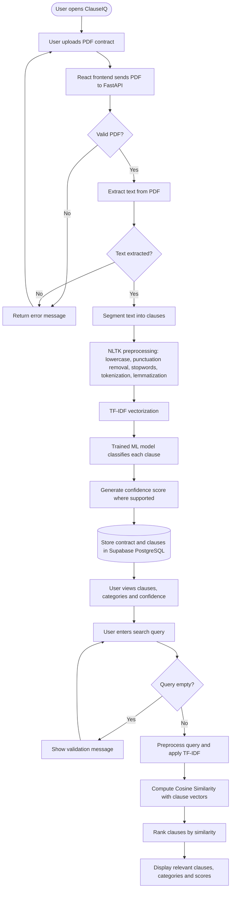
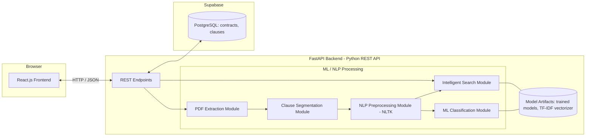

# ClauseIQ – Product Requirements Document (PRD)

**Product:** ClauseIQ – Machine Learning-Based Contract Clause Classification and Intelligent Search System  
**Document version:** 1.0  
**Document type:** Product Requirements Document (academic mini project)  
**Author:** Hanraf (MCA – AI & Data Science, Mar Athanasius College of Engineering)  
**Status:** Draft for project guide review

## Document Control

| Item | Detail |
|---|---|
| Version | 1.0 |
| Audience | Developer, project guide/evaluator, tester, product stakeholder |
| Dataset | CUAD (Contract Understanding Atticus Dataset) |
| Architecture | React Frontend → FastAPI Backend → ML/NLP Processing → Supabase PostgreSQL |
| Conventions | Requirement IDs: FR (functional), NFR (non-functional), UC (use case), AC (acceptance criterion), RSK (risk) |

### Status Legend

| Label | Meaning |
|---|---|
| **Existing** | Part of the current ClauseIQ project scope and stack as described by the project owner |
| **Planned** | In current project scope but completion must be confirmed before submission |
| **Future** | Proposed enhancement; explicitly **not** implemented and **not** in the MVP |
| **TBC** | To Be Confirmed – information not yet available; no assumption is made |

## 1. Document Purpose

This PRD defines what ClauseIQ is, who it is for, what it must do, how it is expected to behave, and how success will be verified. It is written so that a developer can derive implementation tasks, a tester can derive test cases from the acceptance criteria, a project guide can assess scope and rigor, and a stakeholder can understand business value. It does not contain source code and does not describe features outside the stated technology stack.

## 2. Executive Summary

Legal and business contracts are long, dense, and structurally inconsistent. Locating a specific provision (for example, a termination clause, governing-law clause, or non-compete) usually means reading or keyword-searching the entire document. ClauseIQ is a web-based document intelligence application that automates the first step of this work: it accepts a PDF contract, extracts its text, splits it into individual clauses, classifies each clause into one of the predefined CUAD legal categories using classical machine learning, and lets the user find relevant clauses through TF-IDF and Cosine Similarity search.

ClauseIQ is built with React.js on the frontend, FastAPI (Python) on the backend, NLTK-based NLP preprocessing, classical classifiers (Logistic Regression, Linear SVM, Multinomial Naive Bayes, Random Forest) trained on the CUAD dataset, and Supabase PostgreSQL for persistence.

ClauseIQ is a **decision-support and organization tool**. It does **not** provide legal advice, does **not** assess legal risk, and does **not** replace professional legal review. All outputs are model estimates that a human must verify.

---

# Section 1: Product Overview

## 1.1 Product Name
ClauseIQ – Machine Learning-Based Contract Clause Classification and Intelligent Search System.

## 1.2 Product Description
ClauseIQ is a web application where a user uploads a PDF contract. The backend extracts the text, segments it into clauses, preprocesses each clause with NLTK, and classifies it with a trained classical ML model into one of the CUAD clause categories, along with a model-generated confidence score where the model supports it. Results and metadata are stored in Supabase PostgreSQL. A search feature converts the user's keyword or natural-language query into a TF-IDF vector and ranks stored clauses by Cosine Similarity.

## 1.3 Product Vision
To make the first pass through a contract fast, organized, and searchable, so that people can reach the provisions that matter without reading every page linearly.

## 1.4 Product Mission
To apply transparent, well-understood classical NLP and machine learning techniques to contract text, giving users categorized clauses and relevance-ranked search results while keeping the human reviewer in control.

## 1.5 Product Goals

| ID | Goal | Type | Status |
|---|---|---|---|
| G-01 | Convert an uploaded PDF contract into a list of individual, preserved clause texts | Functional | Existing |
| G-02 | Automatically assign each clause to one of the predefined CUAD categories | ML | Existing |
| G-03 | Show model confidence scores honestly, without inflation | Trust | Existing |
| G-04 | Retrieve relevant clauses via TF-IDF and Cosine Similarity | Search | Existing |
| G-05 | Persist contracts and clauses with a correct relationship in Supabase | Data | Existing |
| G-06 | Compare four classical models using standard metrics to justify model selection | Academic/ML | Existing (final results TBC) |
| G-07 | Provide a clean, responsive React interface with meaningful error messages | Usability | Existing |

## 1.6 Product Scope

**In scope (current project):**

- PDF upload and validation.
- Text extraction, clause segmentation, and NLTK preprocessing.
- Classification using Logistic Regression, Linear SVM, Multinomial Naive Bayes, and Random Forest on TF-IDF features.
- Confidence score display where the chosen model supports it.
- TF-IDF + Cosine Similarity clause search.
- Results display, and storage in Supabase PostgreSQL (`contracts`, `clauses` tables).
- Error handling for invalid files, extraction failures, empty queries, and backend errors.

**Should-have/Could-have extensions** (filtering, sorting, export, dashboard, etc.) are listed in Section 6 and are labeled **Planned** or **Future** accordingly.

## 1.7 Product Boundaries

| Boundary | Statement |
|---|---|
| Not legal advice | ClauseIQ never states whether a clause is legally valid, risky, or enforceable |
| Not a replacement for lawyers | Output is an aid for organizing and locating clauses |
| No generative AI | No Deep Learning, LLMs, RAG, or chatbot features |
| No authentication | No user accounts or role management in the current scope |
| Input format | Text-based PDF only; scanned/image PDFs (OCR) are Future |
| Label set | Limited to the CUAD category set; no custom user-defined categories |
| Language | Contract language support is TBC (CUAD is English-language) |

## 1.8 Expected Product Outcomes

| ID | Outcome | How it is verified |
|---|---|---|
| O-01 | A valid text-based PDF yields a list of clauses, each with a predicted category | AC-03, AC-04 |
| O-02 | A search query returns clauses ranked by descending cosine similarity | AC-07 |
| O-03 | Processed results persist and can be re-retrieved with correct contract–clause linkage | AC-09 |
| O-04 | Model comparison table (accuracy, precision, recall, macro F1, weighted F1, confusion matrix) is produced from real evaluation runs | Section 11; results marked TBC until supplied |

## 1.9 What Makes ClauseIQ Useful

- **Structure from unstructured text:** turns a long PDF into labeled, individually addressable clauses.
- **Targeted retrieval:** similarity-ranked search surfaces relevant clauses even when the query is phrased differently from the contract text.
- **Transparent methods:** TF-IDF, linear models, and tree ensembles are explainable and reproducible, which suits academic evaluation.
- **Persistent record:** results are stored in a relational database, enabling later review without reprocessing.
- **Honest confidence reporting:** scores come directly from the model and are never adjusted.

---

# Section 2: Problem Statement

Reviewing contracts manually is slow and error-prone. The table maps each problem to ClauseIQ's response. No quantitative time-saving claim is made; any such claim would require user studies (**TBC**).

| ID | Problem | Impact | ClauseIQ response | Related FR |
|---|---|---|---|---|
| P-01 | **Time-consuming manual review.** Contracts can run to dozens of pages, and each must be read in sequence. | Reviewer effort and delay | Automated extraction, segmentation, and classification produce an organized first-pass view | FR-01 to FR-05 |
| P-02 | **Difficulty identifying specific clauses in lengthy documents.** Headings are inconsistent; provisions may be buried or untitled. | Relevant clauses are missed or found late | Each clause receives a predicted category, so users can look for a type rather than scan pages | FR-05, FR-08 |
| P-03 | **Repetitive manual searching.** Users repeatedly Ctrl+F for different wordings of the same concept. | Redundant effort; synonyms missed | Query-based search ranks clauses by TF-IDF cosine similarity rather than exact string match | FR-07 |
| P-04 | **Difficulty organizing clauses into meaningful categories.** Teams lack a consistent taxonomy. | Inconsistent records | CUAD's predefined 41-category taxonomy provides a consistent labeling scheme | FR-05, FR-09 |
| P-05 | **Challenges retrieving relevant clauses across documents.** Clauses are scattered across separate files. | Cross-document lookup is manual | Clauses from processed contracts are stored in one database and can be searched together (cross-contract scope: see FR-07, TBC) | FR-07, FR-09 |
| P-06 | **Possibility of overlooking important provisions.** Fatigue and volume lead to omissions. | Provisions unnoticed | A systematic per-clause classification list ensures every segmented clause is surfaced; low-confidence results are flagged for human attention | FR-06, FR-08 |

**Important limitation:** ClauseIQ reduces effort in locating and organizing clauses; it cannot guarantee that no provision is overlooked, because segmentation and classification are imperfect (see Section 13).

---

# Section 3: Target Audience and User Personas

Personas below are **illustrative profiles** derived from the intended user groups, not from customer research. No user interviews or surveys have been conducted (**TBC**).

| Persona | Background | Primary goals | Current difficulties | How ClauseIQ helps | Expected benefits |
|---|---|---|---|---|---|
| **P1: Legal Professional / Lawyer** | Reviews agreements for clients; familiar with clause types | Quickly locate specific provisions as a starting point | Lengthy documents; repetitive lookups | Category labels and similarity search to jump to candidate clauses | Faster orientation in a document; professional review remains required |
| **P2: Contract Management Team Member** | Manages many agreements through their lifecycle | Keep clauses organized and findable | Inconsistent filing; manual indexing | Stored, categorized clause records per contract | More consistent clause records |
| **P3: Business Organization User** | Non-lawyer staff handling vendor/service agreements | Understand which provisions a contract contains | Legal language is hard to navigate | Clause list grouped by category with original text | Easier navigation; no interpretation is offered |
| **P4: Administrative / Compliance Personnel** | Checks that agreements contain expected provision types | Verify presence of specific clause types | Reading full documents to confirm presence | Search and category view to find candidate clauses | Faster candidate identification, to be confirmed by a qualified reviewer |
| **P5: Researcher / Student** | Studies legal text or NLP | Explore clause classification and retrieval, compare models | Needs a transparent, reproducible pipeline | Classical, explainable models and a model-comparison view | Learning platform for NLP/ML on legal text |

**Disclaimer applying to all personas:** ClauseIQ does not replace professional legal review and must display a visible notice to that effect (see FR-08 and NFR-USA-03).

---

# Section 4: User Needs and Use Cases

## 4.1 User Needs

| ID | User need | Linked use case |
|---|---|---|
| UN-01 | Get a contract into the system easily | UC-01 |
| UN-02 | Read the contract's text without opening the PDF manually | UC-02 |
| UN-03 | See the contract divided into individual clauses | UC-03 |
| UN-04 | Know what type each clause is | UC-04, UC-05 |
| UN-05 | Find clauses by keywords or natural phrasing | UC-06, UC-07 |
| UN-06 | See the original wording alongside the category | UC-08 |
| UN-07 | Keep results for later | UC-09 |

## 4.2 Use Case Summary

| ID | Use case | Primary actor | Status |
|---|---|---|---|
| UC-01 | Upload a PDF contract | User | Existing |
| UC-02 | Extract textual content | System | Existing |
| UC-03 | Segment document into clauses | System | Existing |
| UC-04 | Classify clauses into categories | System | Existing |
| UC-05 | Display predicted category and confidence | User/System | Existing |
| UC-06 | Search using keywords or natural-language query | User | Existing |
| UC-07 | Retrieve relevant clauses via Cosine Similarity | System | Existing |
| UC-08 | View original clause text and category | User | Existing |
| UC-09 | Store processed contract data in Supabase | System | Existing |

## 4.3 Detailed Use Cases

### UC-01: Upload a PDF Contract (e.g., a company service agreement)
- **Actors:** User (primary); React frontend, FastAPI backend (supporting).
- **Preconditions:** Application is running; backend reachable; user has a PDF file.
- **Main workflow:** (1) User selects a PDF. (2) Frontend checks file type. (3) Frontend sends the file to the FastAPI upload endpoint. (4) Backend validates the file and begins processing.
- **Alternate flows:** Non-PDF file → rejection message. Corrupt PDF → error message. Backend unreachable → connection error message.
- **Expected outcome:** The file is accepted and processing starts; the user sees a progress/status indication.

### UC-02: Extract Textual Content
- **Actors:** System (PDF extraction module).
- **Preconditions:** A valid PDF has been received.
- **Main workflow:** (1) Backend reads PDF pages. (2) Text is extracted and combined in reading order. (3) Extracted text is passed to segmentation.
- **Alternate flows:** Empty or image-only PDF → "no extractable text" error (OCR is Future). Extraction exception → error response, no partial database record.
- **Expected outcome:** A text string representing the contract content.

### UC-03: Segment the Document into Clauses
- **Actors:** System (clause segmentation module).
- **Preconditions:** Non-empty extracted text.
- **Main workflow:** (1) Text is split into candidate clauses using the project's segmentation rules (exact rule set: **TBC**). (2) Original clause text is preserved unaltered for display and storage. (3) A preprocessed copy is generated separately for the model.
- **Alternate flows:** No clauses found → informative message. Very long or very short fragments → handled per segmentation rules (**TBC**).
- **Expected outcome:** An ordered list of clauses.

### UC-04: Classify Clauses
- **Actors:** System (NLP preprocessing and ML classification modules).
- **Preconditions:** Segmented clauses exist; trained model and TF-IDF vectorizer artifacts are available.
- **Main workflow:** (1) Each clause is preprocessed (lowercase, punctuation removal, stopword removal, tokenization, lemmatization via NLTK). (2) The saved TF-IDF vectorizer transforms the text. (3) The selected trained model predicts a category.
- **Alternate flows:** Model artifacts missing → backend error and clear message.
- **Expected outcome:** One predicted category per clause.

### UC-05: Display Predicted Category and Confidence
- **Actors:** User; System.
- **Preconditions:** Classification complete.
- **Main workflow:** (1) Backend returns category and confidence score per clause. (2) Frontend renders them next to the clause text. (3) Where the model gives no probability-like output, the UI shows "Not available" rather than a computed substitute.
- **Expected outcome:** User sees category and, where supported, a model-generated confidence score with an explanatory note that it is an estimate, not a guarantee of correctness.

### UC-06: Search Using Keywords or Natural-Language Query
- **Actors:** User.
- **Preconditions:** At least one processed contract's clauses are available.
- **Main workflow:** (1) User enters a query. (2) Frontend validates it is not empty. (3) Query is sent to the backend search endpoint.
- **Alternate flows:** Empty query → validation message. No matches above zero similarity → "no relevant clauses found".
- **Expected outcome:** Query accepted for retrieval.

### UC-07: Retrieve Relevant Clauses via Cosine Similarity
- **Actors:** System (search module).
- **Preconditions:** TF-IDF vectorizer and clause vectors available.
- **Main workflow:** (1) Query is preprocessed consistently with clause text. (2) Query is transformed with the TF-IDF vectorizer. (3) Cosine Similarity is computed against clause vectors. (4) Clauses are ranked in descending similarity. (5) Top results are returned with similarity scores.
- **Expected outcome:** A ranked list of clauses with category and similarity score. Number of results returned (top-k) is **TBC**.

### UC-08: View Original Clause Text and Category
- **Actors:** User.
- **Preconditions:** Results from UC-05 or UC-07 are displayed.
- **Main workflow:** User reads each result card showing original clause text, predicted category, and score.
- **Expected outcome:** User can verify the model's label against the actual wording.

### UC-09: Store Processed Contract Information in Supabase
- **Actors:** System (backend, Supabase PostgreSQL).
- **Preconditions:** Classification succeeded.
- **Main workflow:** (1) Backend inserts a record into `contracts`. (2) Backend inserts each clause into `clauses` with the contract's `id` as `contract_id`, plus category and confidence score.
- **Alternate flows:** Database connection failure → error message; no orphan clauses are left (see NFR-DAT-02).
- **Expected outcome:** Contract and clauses are persisted with a correct one-to-many link.

---

# Section 5: Functional Requirements

Priorities use MoSCoW (M = Must, S = Should, C = Could). Status uses the legend at the top of this document. Implementation details marked **TBC** are not assumed.

## 5.1 Functional Requirements Summary

| ID | Requirement | Priority | Status |
|---|---|---|---|
| FR-01 | Contract PDF Upload | M | Existing |
| FR-02 | Text Extraction | M | Existing |
| FR-03 | Clause Segmentation | M | Existing |
| FR-04 | Text Preprocessing | M | Existing |
| FR-05 | ML-Based Clause Classification | M | Existing |
| FR-06 | Classification Confidence | M | Existing |
| FR-07 | Intelligent Clause Search | M | Existing |
| FR-08 | Results Display | M | Existing |
| FR-09 | Database Management | M | Existing |
| FR-10 | Error Handling | M | Existing |

## 5.2 Detailed Requirements

### FR-01: Contract PDF Upload (Must)

| ID | Requirement | Business value | Technical implementation |
|---|---|---|---|
| FR-01.1 | The system shall let the user select and upload a PDF contract through the React interface | Entry point to all functionality | React file input; multipart request to a FastAPI endpoint |
| FR-01.2 | The system shall validate that the uploaded file is a PDF (by extension/MIME type and, on the backend, by successful parsing) | Prevents invalid processing | Frontend check plus backend validation |
| FR-01.3 | The system shall reject non-PDF and unreadable files with a clear message and shall not create database records for them | Clear feedback; clean data | HTTP 4xx response with error detail |
| FR-01.4 | The backend shall pass the accepted file to the processing pipeline | Enables end-to-end processing | FastAPI endpoint invoking the extraction module |
| FR-01.5 | Maximum file size and page limit | Protects availability | **TBC** |

### FR-02: Text Extraction (Must)

| ID | Requirement | Notes |
|---|---|---|
| FR-02.1 | The system shall extract text content from every page of a text-based PDF | PDF parsing library: **TBC** (to be named in the technical design) |
| FR-02.2 | The system shall detect empty extraction results (e.g., scanned PDFs) and return a specific error | OCR is Future (FE-01) |
| FR-02.3 | The system shall handle extraction exceptions without crashing and return a meaningful error | Links to FR-10 |

### FR-03: Clause Segmentation (Must)

| ID | Requirement | Notes |
|---|---|---|
| FR-03.1 | The system shall split extracted text into individual clauses | Segmentation rule set (sentence-based, numbering-based, or hybrid): **TBC** |
| FR-03.2 | The system shall preserve the original, unmodified clause text for display, storage, and search results | Preprocessing must never overwrite the original |
| FR-03.3 | The system shall maintain clause order within the contract | Supports contract-level viewing |
| FR-03.4 | The system shall handle documents that yield zero clauses with an informative message | Links to FR-10 |

### FR-04: Text Preprocessing (Must)

Preprocessing is applied consistently to training data, clause text at inference time, and search queries so that the TF-IDF vector space is shared.

| ID | Step | Description |
|---|---|---|
| FR-04.1 | Lowercase conversion | Normalizes case |
| FR-04.2 | Punctuation removal | Removes punctuation characters |
| FR-04.3 | Stopword removal | Removes common English stopwords (NLTK stopword list) |
| FR-04.4 | Tokenization | Splits text into tokens (NLTK) |
| FR-04.5 | Lemmatization | Reduces tokens to lemmas (NLTK lemmatizer) |
| FR-04.6 | Consistency | The same pipeline shall be used in training, classification, and search |

### FR-05: ML-Based Clause Classification (Must)

| ID | Requirement | Notes |
|---|---|---|
| FR-05.1 | The system shall predict a CUAD category for each clause using a trained classical ML model on TF-IDF features | |
| FR-05.2 | The system shall support four algorithms: Logistic Regression, Linear SVM, Multinomial Naive Bayes, Random Forest | Implementation status of each in the deployed application: **TBC** |
| FR-05.3 | The system shall load pre-trained model artifacts and the fitted TF-IDF vectorizer rather than retraining on each request | Dependency: artifact availability (RSK-08) |
| FR-05.4 | The model used for live predictions shall be the one selected via the comparison in Section 11 | Selected model: **TBC** pending final evaluation |
| FR-05.5 | The system shall return exactly one predicted category per clause | Multi-label prediction is out of scope |

**How a prediction is generated:** (1) the clause is preprocessed per FR-04; (2) the saved TF-IDF vectorizer converts the cleaned text to a sparse weighted vector; (3) the selected trained classifier maps that vector to one of the category labels it learned from CUAD; (4) where supported, the model's score for that label is returned as the confidence value; (5) the numeric label is converted back to its category name using the saved label mapping (**TBC**: exact encoder artifact).

### FR-06: Classification Confidence (Must)

| ID | Requirement | Notes |
|---|---|---|
| FR-06.1 | The system shall display a model-generated confidence score per clause where the model supports one | Logistic Regression, Multinomial Naive Bayes, and Random Forest expose class probabilities. Linear SVM does not natively output probabilities; its decision-function margin or an optional calibration step may be used. **Which approach is used: TBC** |
| FR-06.2 | Where no confidence score is supported, the interface shall show "Not available" | No substitute value shall be invented |
| FR-06.3 | The interface shall state that scores are model estimates, not guaranteed probabilities of correctness | Visible helper text or tooltip |
| FR-06.4 | Scores shall not be fabricated, rescaled for appearance, or artificially increased | Integrity requirement; testable via AC-05 |
| FR-06.5 | Low-confidence threshold for visual flagging | **TBC** |

### FR-07: Intelligent Clause Search (Must)

| ID | Requirement | Notes |
|---|---|---|
| FR-07.1 | The system shall accept a keyword or natural-language text query | |
| FR-07.2 | The system shall preprocess the query using the FR-04 pipeline | |
| FR-07.3 | The system shall transform the query with the TF-IDF vectorizer and compute Cosine Similarity against clause vectors | |
| FR-07.4 | The system shall rank clauses by descending similarity score and return the top results | Top-k value: **TBC** |
| FR-07.5 | The system shall return the original clause text, predicted category, and similarity score for each result | |
| FR-07.6 | Search scope (current contract only, or all stored contracts) | **TBC**; the data model supports both |
| FR-07.7 | The system shall reject empty queries with a message | Links to FR-10 |

Note on semantics: TF-IDF with Cosine Similarity measures lexical overlap, not deep meaning. A query using words absent from a clause will score low even if the meaning is related. This is a known limitation (RSK-10).

### FR-08: Results Display (Must)

| ID | Requirement |
|---|---|
| FR-08.1 | Display the list of extracted clauses for the processed contract |
| FR-08.2 | Display each clause's predicted category |
| FR-08.3 | Display each clause's confidence score, or "Not available" |
| FR-08.4 | Display search results with similarity scores |
| FR-08.5 | Display a persistent notice that ClauseIQ is not legal advice and does not replace professional legal review |
| FR-08.6 | Present results in a responsive layout usable on desktop and mobile browsers |

### FR-09: Database Management (Must)

| ID | Requirement | Notes |
|---|---|---|
| FR-09.1 | Store contract metadata (name, creation time) in the `contracts` table | See Section 10 |
| FR-09.2 | Store each clause's text, predicted category, and confidence score in the `clauses` table | |
| FR-09.3 | Each clause shall reference its parent contract through `contract_id` | One-to-many relationship |
| FR-09.4 | A contract and its clauses shall be saved together so a failed save does not leave partial data | Transaction/rollback approach: **TBC** |

### FR-10: Error Handling (Must)

| ID | Condition | Required behavior |
|---|---|---|
| FR-10.1 | Invalid or non-PDF file | Reject with an explanatory message |
| FR-10.2 | Corrupt PDF or extraction failure | Return an extraction error; no records saved |
| FR-10.3 | Empty document / no extractable text | Message indicating no text was found |
| FR-10.4 | Empty search query | Validation message; no backend search executed |
| FR-10.5 | Missing model artifacts or database connectivity failure | User-friendly error, technical detail logged server-side |
| FR-10.6 | Unexpected backend exception | Generic error message; no stack traces exposed to the user |

---

# Section 6: Must-Have vs Nice-to-Have Features (MoSCoW)

## 6.1 Prioritization Table

| ID | Feature | MoSCoW | Status | Linked FR/NFR |
|---|---|---|---|---|
| F-01 | PDF contract upload | Must | Existing | FR-01 |
| F-02 | PDF text extraction | Must | Existing | FR-02 |
| F-03 | Clause segmentation | Must | Existing | FR-03 |
| F-04 | NLP preprocessing (NLTK) | Must | Existing | FR-04 |
| F-05 | ML-based clause classification | Must | Existing | FR-05 |
| F-06 | Classification confidence display | Must | Existing | FR-06 |
| F-07 | TF-IDF and Cosine Similarity search | Must | Existing | FR-07 |
| F-08 | Search results with clause text and categories | Must | Existing | FR-07, FR-08 |
| F-09 | Supabase database integration | Must | Existing | FR-09 |
| F-10 | Responsive React interface | Must | Existing | FR-08.6, NFR-USA |
| F-11 | Error handling | Must | Existing | FR-10 |
| F-12 | Filtering clauses by category | Should | Planned (status TBC) | FR-08 extension |
| F-13 | Sorting search results by similarity | Should | Planned (status TBC) | FR-07.4 |
| F-14 | Viewing all clauses of a contract | Should | Planned (status TBC) | FR-08.1 |
| F-15 | Model performance information view | Should | Planned (status TBC) | Section 11 |
| F-16 | Download/export of processed clause results | Should | Planned (status TBC) | FR-08 extension |
| F-17 | Contract comparison | Could | Future | FE-02 |
| F-18 | Advanced search filters | Could | Future | FE-04 |
| F-19 | Clause-level highlighting | Could | Future | FE-03 |
| F-20 | Dashboard with document statistics | Could | Future | FE-04 |
| F-21 | Search history | Could | Future | FE-04 |
| F-22 | Deep Learning models | Won't | Out of scope | Boundary |
| F-23 | Large Language Models (LLMs) | Won't | Out of scope | Boundary |
| F-24 | Retrieval-Augmented Generation (RAG) | Won't | Out of scope | Boundary |
| F-25 | AI chatbot / conversational legal assistant | Won't | Out of scope | Boundary |
| F-26 | Automated legal advice | Won't | Out of scope | Boundary |
| F-27 | Legal risk prediction | Won't | Out of scope | Boundary |
| F-28 | Automatic contract generation | Won't | Out of scope | Boundary |
| F-29 | User authentication and multi-user role management | Won't | Out of scope (current scope); revisited as FE-05/FE-06 | Boundary |

## 6.2 Existing vs Proposed Summary

| Category | Features |
|---|---|
| **Existing (MVP)** | F-01 to F-11 |
| **Planned (current scope, status to be confirmed by project owner)** | F-12 to F-16 |
| **Future enhancements (not implemented)** | F-17 to F-21, plus items in Section 14 |
| **Excluded from scope** | F-22 to F-29 |

The classification of F-12 to F-16 as Planned rather than Existing is an assumption of this draft because the brief lists them as Should-Have; the project owner should confirm each before final submission.

---

# Section 7: Non-Functional Requirements

No performance figure below is claimed as an achieved result. Targets are **proposed acceptance thresholds** that must be measured during testing; where a value cannot responsibly be proposed it is marked **TBC**.

| ID | Category | Requirement | Measurable / testable acceptance criterion |
|---|---|---|---|
| NFR-PER-01 | Performance | Processing a typical text-based contract PDF shall complete in an acceptable time | Proposed target: **TBC** (measure on sample contracts and record in test report) |
| NFR-PER-02 | Performance | Search shall respond quickly after a query is submitted | Proposed target: **TBC**; measured using the sample dataset |
| NFR-PER-03 | Performance | Model and vectorizer artifacts shall be loaded once at backend startup, not per request | Verified by code review/log inspection |
| NFR-REL-01 | Reliability | A failure in one request shall not crash the backend | Induced invalid input returns an error response and the server continues serving the next request |
| NFR-REL-02 | Reliability | Identical input and model artifacts shall give identical predictions | Repeating the same clause twice yields the same category and score |
| NFR-USA-01 | Usability | The interface shall be operable without training | A first-time user can upload a PDF and run a search (informal usability check; participants TBC) |
| NFR-USA-02 | Usability | Error messages shall be specific and actionable | Each FR-10 condition shows a distinct readable message |
| NFR-USA-03 | Usability | A "not legal advice" notice shall always be visible with results | Visual inspection on results screen |
| NFR-USA-04 | Usability | Layout shall be responsive | Verified on desktop and mobile-width viewports in a modern browser |
| NFR-SCA-01 | Scalability | The design shall allow more contracts and clauses to be stored without schema change | Database tables use one-to-many relationship; no hard-coded row limits |
| NFR-SCA-02 | Scalability | Current scalability limits (in-memory vectors, single backend instance) shall be documented | Documented in design notes; limits TBC |
| NFR-MNT-01 | Maintainability | Extraction, segmentation, preprocessing, classification, and search shall be separate modules | Each module has a distinct responsibility and is testable alone |
| NFR-MNT-02 | Maintainability | Training and inference preprocessing shall share one implementation | Code review confirms no duplicate preprocessing logic |
| NFR-MNT-03 | Maintainability | Model artifacts shall be versioned and documented | Artifact names and training date recorded (format TBC) |
| NFR-SEC-01 | Security | Uploads shall be validated for type before processing | Non-PDF uploads rejected (AC-01) |
| NFR-SEC-02 | Security | Database credentials and keys shall not be hard-coded or exposed to the browser | Secrets held in backend environment configuration; verified by code/config review |
| NFR-SEC-03 | Security | Contract content is potentially confidential and shall be handled accordingly | Data retention and deletion policy: **TBC**. No authentication in current scope, so the system is intended for demonstration use, not for confidential production documents |
| NFR-SEC-04 | Security | Cross-origin access shall be restricted to the frontend origin | Backend CORS configuration review |
| NFR-DAT-01 | Data integrity | Each clause shall reference an existing contract | Foreign-key constraint on `clauses.contract_id` |
| NFR-DAT-02 | Data integrity | Contract and clause inserts shall be atomic | No clause rows exist for a contract whose save failed |
| NFR-DAT-03 | Data integrity | Stored clause text shall equal the extracted clause text | Comparison test on sample document |
| NFR-COM-01 | Compatibility | The frontend shall work in current versions of major desktop browsers | Browser list and version matrix: **TBC** |
| NFR-COM-02 | Compatibility | Input format shall be PDF only | Other formats rejected |
| NFR-AVL-01 | Availability | Availability depends on backend host and Supabase service | Uptime target: **TBC**; no SLA is claimed for an academic project |
| NFR-ERR-01 | Error recovery | After any handled error, the user shall be able to retry without reloading | Verified after each FR-10 scenario |
| NFR-ERR-02 | Error recovery | Failed saves shall be rolled back or reported | See NFR-DAT-02 |
| NFR-ERR-03 | Error recovery | Server-side errors shall be logged with enough detail to diagnose | Log inspection after induced failure |

---

# Section 8: User Journey and Workflow

## 8.1 Step-by-Step Journey

| Step | Actor | Action | Related requirement |
|---|---|---|---|
| 1 | User | Opens ClauseIQ in a browser | NFR-COM-01 |
| 2 | User | Uploads a PDF contract | FR-01 |
| 3 | Frontend | Sends the PDF to the FastAPI backend | FR-01.4 |
| 4 | Backend | Extracts document text | FR-02 |
| 5 | Backend | Divides text into clauses | FR-03 |
| 6 | Backend | Performs NLP preprocessing on each clause | FR-04 |
| 7 | Backend | Trained ML model classifies each clause | FR-05 |
| 8 | Backend | Generates confidence scores where supported | FR-06 |
| 9 | Backend | Stores processed contract information in Supabase | FR-09 |
| 10 | User | Views classification results | FR-08 |
| 11 | User | Enters a search query | FR-07.1 |
| 12 | Backend | TF-IDF and Cosine Similarity retrieve relevant clauses | FR-07 |
| 13 | Frontend | Displays ranked relevant results with similarity scores | FR-08.4 |

## 8.2 Workflow Diagram



---

# Section 9: System Architecture and Components

## 9.1 Architecture Overview

ClauseIQ follows a layered architecture: **React Frontend → FastAPI Backend → ML/NLP Processing → Supabase PostgreSQL**. The backend orchestrates the processing modules and is the only layer that communicates with the database.



## 9.2 Component Responsibilities

| Component | Responsibilities | Inputs | Outputs | Requirements |
|---|---|---|---|---|
| **React frontend** | File selection and client-side validation; sending requests; showing loading state, clauses, categories, confidence, search results, error messages; responsive layout; legal-disclaimer notice | User actions; API JSON | Rendered UI | FR-01, FR-08, FR-10, NFR-USA |
| **FastAPI backend** | Exposes REST endpoints; validates requests; orchestrates modules; loads artifacts at startup; handles database access; returns structured errors; CORS control | HTTP requests | JSON responses | FR-01, FR-09, FR-10, NFR-SEC |
| **PDF extraction module** | Reads PDF pages and returns text; detects empty/failed extraction | PDF bytes | Raw text | FR-02 |
| **Clause segmentation module** | Splits text into ordered clauses; retains original text | Raw text | List of clauses | FR-03 |
| **NLP preprocessing module** | Applies lowercasing, punctuation removal, stopword removal, tokenization, lemmatization (NLTK) for clauses and queries | Clause or query text | Cleaned text | FR-04 |
| **ML classification module** | Applies TF-IDF vectorizer and selected trained classifier; returns category and confidence where supported | Cleaned clause text | Category, confidence | FR-05, FR-06 |
| **Intelligent search module** | Vectorizes query; computes Cosine Similarity; ranks and returns top results | Query, clause vectors | Ranked clauses with scores | FR-07 |
| **Supabase PostgreSQL** | Persists contracts and clauses; enforces keys and relationship; supports retrieval | Insert/query requests | Stored records | FR-09, NFR-DAT |

## 9.3 Proposed API Surface

Endpoint names and payloads are **TBC** and are not specified here to avoid assuming the existing implementation. Functionally, the API must offer: (a) upload-and-process contract, (b) retrieve a contract's clauses, (c) search clauses by query, and (d) optionally retrieve model information (Should-Have).

---

# Section 10: Data Requirements

## 10.1 CUAD Dataset

The Contract Understanding Atticus Dataset (CUAD) contains **510 contracts** annotated with **41 predefined clause categories** (original dataset). ClauseIQ uses CUAD as its source of labeled clause examples. The dataset licence terms and citation requirements should be recorded in the final project report (**TBC**).

## 10.2 The 41 Clause Categories

The authoritative list of the 41 category names is defined by CUAD and is **TBC** in this document, to be copied from the project's processed dataset (`category` column) so that the PRD matches the project exactly. This avoids listing names from memory that might differ from the project's data.

## 10.3 Processed Dataset Structure

The processed dataset contains approximately **12,204** clause records (approximate, per project owner) with three main columns:

| Column | Description |
|---|---|
| `contract_id` | Identifier of the source contract |
| `clause_text` | Text of the clause |
| `category` | One of the CUAD clause categories |

Whether the final 12,204 count covers all 41 categories (including any with very few samples) is **TBC**.

## 10.4 Training and Testing Data

| Aspect | Requirement | Status |
|---|---|---|
| Split | Train/test split of the processed dataset | 80/20 train/test ratio (Split A: 9,763 train / 2,441 test; Split B: 9,718 train / 2,486 test) |
| Stratification | Stratified splitting so rare categories appear in both sets | IMPLEMENTED (StratifiedShuffleSplit, seed=42) |
| Leakage control | Grouped splitting by contract_id so no contract appears in both train and test | IMPLEMENTED (StratifiedGroupKFold / GroupShuffleSplit, 408 train / 102 test contracts) |
| Class imbalance | Category counts are uneven; balanced class weights used during training | IMPLEMENTED (`class_weight='balanced'`) |
| Reproducibility | Fixed random seed recorded | `random_state=42` across all splits and models |

## 10.5 Model Artifacts

| Artifact | Purpose | Notes |
|---|---|---|
| TF-IDF vectorizer | Converts preprocessed text to weighted vectors (`artifacts/tfidf_vectorizer.joblib`) | Hybrid Word (25k) + Char_wb (15k) = 40,000 features |
| Trained classifiers | Logistic Regression, Linear SVM, Multinomial Naive Bayes, Random Forest | Selected model: `LogisticRegression` (balanced weights, C=1.0) saved in `artifacts/best_model.joblib` |
| Label mapping | Maps numeric labels to 41 category names (`artifacts/label_encoder.joblib`) | `LabelEncoder` saved with 41 classes |
| Clause vectors for search | TF-IDF vectors of 12,204 corpus clauses | Pre-indexed in memory on startup for instant similarity computation |
| Manifest | System metadata (`artifacts/manifest.json`) | Model name, feature dimensions, split hashes, date |

## 10.6 Database Schema (Supabase PostgreSQL)

**contracts**

| Column | Description |
|---|---|
| `id` | Primary key, unique contract identifier |
| `contract_name` | Name of the uploaded contract |
| `created_at` | Timestamp of creation |

**clauses**

| Column | Description |
|---|---|
| `id` | Primary key, unique clause identifier |
| `contract_id` | Foreign key referencing `contracts.id` |
| `clause_text` | Original extracted clause text |
| `category` | Predicted category |
| `confidence_score` | Model-generated confidence score (nullable where the model provides none) |
| `created_at` | Timestamp of creation |

Column data types, key types, and indexes are **TBC**.

```mermaid
erDiagram
    CONTRACTS ||--o{ CLAUSES : contains
    CONTRACTS {
        id PK
        contract_name
        created_at
    }
    CLAUSES {
        id PK
        contract_id FK
        clause_text
        category
        confidence_score
        created_at
    }
```

## 10.7 One-to-Many Relationship

One contract contains many clauses; each clause belongs to exactly one contract. `clauses.contract_id` references `contracts.id`. Consequences: (1) a contract's full clause list is retrieved by filtering on `contract_id`; (2) a clause cannot exist without a contract (enforced by foreign key, NFR-DAT-01); (3) deleting a contract requires a defined rule for its clauses (cascade or restrict: **TBC**); (4) cross-contract search is possible because all clauses share one table.

---

# Section 11: ML Model Requirements

All four models operate on TF-IDF features of NLTK-preprocessed clause text. Using several algorithms enables a documented, evidence-based model selection.

## 11.1 Algorithms

| Algorithm | Purpose in ClauseIQ | Why suitable for text classification | Considerations |
|---|---|---|---|
| **Logistic Regression** | Baseline multi-class classifier; supplies class probabilities | Works well on high-dimensional sparse TF-IDF vectors; fast; coefficients are interpretable; probability outputs support confidence display | Linear decision boundaries; class weighting may help imbalance (**TBC** whether used) |
| **Linear Support Vector Machine** | Margin-based classifier, often strong on text | Effective in high-dimensional sparse spaces; robust with many features | No native probabilities; confidence handling per FR-06.1 (**TBC**) |
| **Multinomial Naive Bayes** | Lightweight probabilistic baseline | Designed for count/weighted term features; very fast; performs reasonably with small data | Independence assumption; probability estimates can be poorly calibrated |
| **Random Forest** | Non-linear ensemble for comparison | Captures feature interactions; resistant to some overfitting through averaging | Slower and heavier on very high-dimensional sparse text; larger artifact size; usually less natural for TF-IDF than linear models |

## 11.2 Evaluation Metrics

| Metric | Definition (short) | Why it matters for ClauseIQ |
|---|---|---|
| Accuracy | Share of clauses correctly classified | Overall indicator, but misleading under class imbalance |
| Precision | Of clauses predicted as a class, how many are correct (per class) | Shows false-positive behavior per category |
| Recall | Of true clauses of a class, how many were found (per class) | Shows missed clauses, important for review use |
| Macro F1-score | Unweighted average of per-class F1 | Treats rare and common categories equally; key for imbalanced data |
| Weighted F1-score | Average of per-class F1 weighted by class support | Reflects performance on the actual data distribution |
| Confusion Matrix | Table of true vs. predicted classes | Reveals which categories are confused with each other |

## 11.3 Model Comparison and Selection

All four models shall be trained on the same training split and evaluated on the same held-out test split with the same metrics. Selection shall consider macro F1 (rare-category fairness) alongside weighted F1 and accuracy, inspect the confusion matrix for systematic confusions, and weigh practical factors (artifact size, inference speed, availability of confidence scores). The selection rule and tie-breaking are **TBC** and must be written down before results are viewed, to avoid selecting by hindsight.

## 11.4 Results Template (placeholders only)

No results are asserted in this PRD. Replace placeholders with actual evaluation outputs.

| Model | Accuracy | Precision (macro) | Recall (macro) | Macro F1 | Weighted F1 | Notes |
|---|---|---|---|---|---|---|
| Logistic Regression | [RESULT TBC] | [RESULT TBC] | [RESULT TBC] | [RESULT TBC] | [RESULT TBC] | |
| Linear SVM | [RESULT TBC] | [RESULT TBC] | [RESULT TBC] | [RESULT TBC] | [RESULT TBC] | |
| Multinomial Naive Bayes | [RESULT TBC] | [RESULT TBC] | [RESULT TBC] | [RESULT TBC] | [RESULT TBC] | |
| Random Forest | [RESULT TBC] | [RESULT TBC] | [RESULT TBC] | [RESULT TBC] | [RESULT TBC] | |

Confusion matrices: [FIGURES TBC]. Selected production model: [TBC].

---

# Section 12: Acceptance Criteria

Each Must-Have feature has at least one testable criterion. Test data (sample PDFs) and pass/fail evidence shall be recorded in the project test report (**TBC**).

| ID | Feature / FR | Given / When / Then | Test method |
|---|---|---|---|
| AC-01 | F-01 / FR-01 | **Given** a valid PDF, **when** it is uploaded, **then** the upload succeeds and processing starts. **Given** a non-PDF file, **then** it is rejected with a message and no database record is created | Manual + API test with valid, non-PDF, and renamed-extension files |
| AC-02 | F-02 / FR-02 | **Given** a text-based PDF, **when** processed, **then** non-empty text is extracted. **Given** an empty/image-only PDF, **then** a specific "no extractable text" error is shown | Test with sample and empty/scanned PDFs |
| AC-03 | F-03 / FR-03 | **Given** extracted text, **then** it is passed to segmentation and an ordered list of clauses is produced with original text preserved | Compare segmented output with source text on a sample contract |
| AC-04 | F-04, F-05 / FR-04, FR-05 | **Given** segmented clauses, **then** every clause is preprocessed and receives exactly one predicted category from the CUAD label set | Check that no clause lacks a category and all labels belong to the label set |
| AC-05 | F-06 / FR-06 | **Given** a model that supports probabilities, **then** a score is returned and displayed unaltered. **Given** a model without scores, **then** "Not available" is shown. Scores are never fabricated or boosted | Compare displayed values with raw model output; inspect code for adjustments |
| AC-06 | F-05 / FR-05.2 | Each supported model type loads from its artifact and returns a prediction for a sample clause | Per-model smoke test (models actually wired into the app: **TBC**) |
| AC-07 | F-07 / FR-07 | **Given** a non-empty query, **then** results are returned ranked by descending cosine similarity and the displayed scores are in that order | Independent cosine computation on a small sample to confirm ranking |
| AC-08 | F-08 / FR-08 | **Given** search or classification results, **then** each shows original clause text, predicted category, and the relevant score; the legal notice is visible | UI inspection |
| AC-09 | F-09 / FR-09 | **Given** a processed contract, **then** one `contracts` row and N `clauses` rows exist, each clause `contract_id` equals the contract `id`, and clause text equals the extracted text | Database query after processing |
| AC-10 | F-09 / NFR-DAT-02 | **Given** a simulated failure during save, **then** no orphan clause rows remain or the failure is reported | Fault-injection test |
| AC-11 | F-10 / NFR-USA-04 | The interface is usable and not visually broken at desktop and mobile widths | Browser responsive-mode check |
| AC-12 | F-11 / FR-10 | **Given** invalid PDF, extraction failure, empty query, missing artifacts, or database error, **then** a distinct, readable error message is shown and the application stays usable | One test per FR-10 row |
| AC-13 | F-05 / FR-05.3 | Model artifacts are loaded once at startup and not retrained per request | Log/code inspection |
| AC-14 | Section 11 | A model comparison table with the six metrics and confusion matrices exists, filled with real results | Review of evaluation report |

---

# Section 13: Risks, Limitations, and Dependencies

## 13.1 Risks and Limitations

| ID | Risk / limitation | Likelihood / impact | Mitigation |
|---|---|---|---|
| RSK-01 | **Imbalanced clause categories**: some categories have many more examples than others | Likelihood and extent **TBC** (check class counts); impact: bias toward frequent classes | Report per-class counts; use macro F1 as a primary metric; consider class weighting or resampling on the training split only |
| RSK-02 | **Limited samples for certain categories** | Poor recall for rare categories | Flag rare categories; evaluate with per-class recall; consider merging only if documented; disclose in model information view |
| RSK-03 | **Classification errors** | Always possible | Show original text beside the label; legal-review notice; confusion matrix analysis |
| RSK-04 | **Low confidence scores** | Users may over- or under-trust labels | Display scores honestly; visually flag below a threshold (**TBC**); explain meaning of scores |
| RSK-05 | **PDF extraction quality** (layout, columns, headers/footers, scanned pages) | Garbled or missing text | Detect empty extraction; test on varied PDFs; OCR is Future |
| RSK-06 | **Complex clause boundaries** (nested numbering, sub-clauses, run-on sentences) | Clauses split or merged incorrectly | Document the segmentation rule; test on sample contracts; allow future refinement |
| RSK-07 | **Dataset limitations**: CUAD is English, US-oriented commercial contracts, and its processed clause texts may differ from segments produced from uploaded PDFs | Distribution mismatch lowers real-world accuracy | State the limitation; evaluate on a few real uploaded contracts (results **TBC**) |
| RSK-08 | **Dependency on trained model artifacts** | App cannot classify if artifacts missing or version-mismatched | Version artifacts; startup check with clear error; keep library versions pinned |
| RSK-09 | **Dependency on database connectivity (Supabase)** | Save/retrieve fails during outage | Error handling per FR-10.5; retry; atomic writes |
| RSK-10 | **Lexical search limitation**: TF-IDF/Cosine Similarity does not understand synonyms or meaning | Relevant clauses with different wording may rank low | Document the limitation; preprocessing (lemmatization) helps partially; no LLM/embedding approach in scope |
| RSK-11 | **Misuse as legal advice** | Reliance on automated labels | Persistent disclaimer; no risk scoring or advice features |
| RSK-12 | **Confidentiality of uploaded contracts** with no authentication | Exposure of sensitive data | Use only sample or non-confidential contracts; retention policy **TBC**; authentication is Future |
| RSK-13 | **Evaluation leakage** (same-contract clauses in train and test) | Inflated metrics | Consider grouped splitting by `contract_id` (**TBC**) |

## 13.2 Dependencies

| ID | Dependency | Notes |
|---|---|---|
| DEP-01 | CUAD dataset and its processed version | Source of training data |
| DEP-02 | NLTK resources (tokenizer, stopwords, lemmatizer data) | Must be available in the deployment environment |
| DEP-03 | Trained model artifacts and TF-IDF vectorizer | See RSK-08 |
| DEP-04 | Supabase PostgreSQL service | See RSK-09 |
| DEP-05 | PDF parsing library | Library name **TBC** |
| DEP-06 | Hosting for React frontend and FastAPI backend | Provider **TBC** |

---

# Section 14: Future Enhancements

The items below are **future possibilities only**. They are **not implemented**, **not part of the current MVP**, and are not commitments.

| ID | Enhancement | Description | Rationale | Prerequisite |
|---|---|---|---|---|
| FE-01 | OCR for scanned PDFs | Extract text from image-based PDFs | Addresses RSK-05 | An OCR tool compatible with the stack (**TBC**) |
| FE-02 | Contract comparison | Compare clause categories present across two contracts | Supports review of differences | Stable multi-contract storage (already supported by schema) |
| FE-03 | Advanced clause highlighting | Highlight clauses within the source document view | Easier verification | Position tracking in extraction |
| FE-04 | Advanced filtering and reporting | Search filters, dashboard statistics, search history, export reports | Better navigation and oversight | Additional tables/endpoints |
| FE-05 | Multi-user authentication | User accounts and per-user data | Needed for confidential use | Authentication design |
| FE-06 | Role-based access | Roles with different permissions | Organizational use | FE-05 |
| FE-07 | Support for additional document formats | e.g., Word files | Wider input coverage | Extraction modules per format |

Explicitly excluded from the project at all stages of this PRD: Deep Learning models, LLMs, RAG, chatbot features, automated legal advice, legal risk prediction, and contract generation.

---

# Appendix A: Open Items (To Be Confirmed)

| # | Item | Owner | Why it matters |
|---|---|---|---|
| 1 | Which of the four models are wired into the running application, and which one is the default | Developer | FR-05.2, FR-05.4 |
| 2 | Whether NLTK is used end to end for preprocessing in both training and the application | Developer | FR-04, NFR-MNT-02 (early development scripts may use different tooling; the PRD follows the stated NLTK stack) |
| 3 | PDF extraction library and clause segmentation rules | Developer | FR-02, FR-03 |
| 4 | Confidence handling for Linear SVM | Developer | FR-06.1 |
| 5 | Final evaluation results and train/test split details | Developer | Section 11.4, AC-14 |
| 6 | Exact list of the 41 categories | Developer | Section 10.2 |
| 7 | Search scope, top-k, file size limit, thresholds | Project owner | FR-01.5, FR-06.5, FR-07 |
| 8 | Status of Should-Have features F-12 to F-16 | Project owner | Section 6 |
| 9 | Database types, constraints, delete rule | Developer | Section 10.6, 10.7 |
| 10 | Hosting, retention policy, browser matrix | Project owner | NFR-AVL, NFR-SEC-03, NFR-COM-01 |

# Appendix B: Glossary

| Term | Meaning |
|---|---|
| CUAD | Contract Understanding Atticus Dataset, an annotated corpus of commercial contracts |
| TF-IDF | Term Frequency–Inverse Document Frequency; weights terms by importance within a text relative to a corpus |
| Cosine Similarity | Measure of angle-based similarity between two vectors; higher means more similar |
| Macro F1 | F1-score averaged equally over all classes |
| Weighted F1 | F1-score averaged by class size |
| MoSCoW | Must / Should / Could / Won't prioritization |
| MVP | Minimum viable product |
