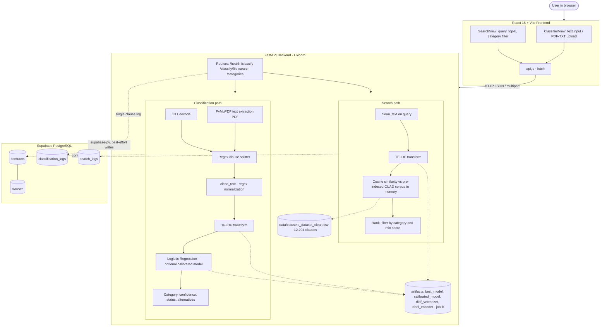

# ClauseIQ – Technology Stack

**Project:** ClauseIQ – Machine Learning-Based Contract Clause Classification and Intelligent Search System
**Document basis:** Static inspection of the shared project workspace (source code, dependency files, SQL schema, results, docs, git metadata). No source code was modified, no packages were installed, and the test suite and application were **not executed** for this document.
**Secrets:** No credential values appear in this document. Environment variables are described by name only.

## Status Legend

| Label | Meaning |
|---|---|
| **IMPLEMENTED** | Working code exists in the repository and is used by the application or pipeline |
| **CONFIGURED** | Dependency, file, or setting exists, but the code does not functionally use it (or it cannot be verified as live) |
| **PLANNED** | Mentioned in project documents as intended work; no code |
| **NOT IMPLEMENTED** | No evidence in the repository |
| **TO BE CONFIRMED** | Cannot be verified from the repository |

---

## 1. Project Overview

ClauseIQ is a web application for analyzing legal and business contracts. A user can paste a single clause or upload a contract (**PDF or plain text**). The backend extracts text, splits it into clauses, and classifies each clause into one of **41 CUAD legal categories** using a classical machine learning model on TF-IDF features. A separate search feature ranks clauses from a **pre-indexed CUAD corpus** (12,204 clauses) against a text query using TF-IDF and Cosine Similarity. Processed uploads and usage logs are written to Supabase PostgreSQL on a best-effort basis.

ClauseIQ does **not** use Deep Learning, LLMs, RAG, or chatbot components, and none were found in the repository.

**Repository layout (verified):** `api/` (FastAPI app, routers, services), `src/` (NLP, training, search, evaluation scripts), `frontend/` (React + Vite), `database/schema.sql`, `artifacts/` (runtime model files), `data/` (CUAD-derived CSVs, sample PDF), `results/`, `figures/`, `eda_outputs/`, `notebooks/EDA.ipynb`, `docs/`, `reports/`, `tests/`, `test_data/`, `scratch/` (experiments).

---

## 2. Technology Stack Summary

| Layer | Technology | Purpose | Implementation Status |
|---|---|---|---|
| Frontend | React 18 (JavaScript/JSX) + Vite | Single-page UI for classification and search | IMPLEMENTED |
| Frontend styling | Plain CSS (`index.css`), Google Fonts link | Layout and theme | IMPLEMENTED |
| API communication | Browser `fetch` over REST/JSON and multipart | Frontend-to-backend calls | IMPLEMENTED |
| Backend | Python, FastAPI, Uvicorn | REST API and orchestration | IMPLEMENTED |
| Validation | Pydantic models (`api/schemas.py`) | Request/response schemas | IMPLEMENTED |
| PDF processing | PyMuPDF (`pymupdf`) | Text extraction from PDF | IMPLEMENTED |
| Clause segmentation | Regular expressions (`src/clause_splitter.py`) | Split text into clauses | IMPLEMENTED |
| Clause segmentation | spaCy `en_core_web_sm` | Loaded at import but result never used | CONFIGURED |
| Text cleaning | Python `re` (`src/text_cleaner.py`) | Lowercase, URL/email/symbol removal | IMPLEMENTED |
| NLP | NLTK | Listed in `requirements.txt`; never imported in code | CONFIGURED (not used) |
| Feature extraction | scikit-learn `TfidfVectorizer` | Unigram+bigram TF-IDF, 10,000 features | IMPLEMENTED |
| ML (served) | Logistic Regression (+ optional calibrated model) | Clause classification with probabilities | IMPLEMENTED |
| ML (trained and compared) | Linear SVM, Multinomial Naive Bayes, Random Forest | Benchmark models | IMPLEMENTED (training/evaluation only, not served) |
| Search | scikit-learn `cosine_similarity` | Rank corpus clauses by similarity | IMPLEMENTED |
| Model persistence | joblib (`.joblib`, `.pkl`) | Save/load model, vectorizer, encoder | IMPLEMENTED |
| Database | Supabase PostgreSQL via `supabase` Python client | Store contracts, clauses, logs | IMPLEMENTED in code; live project status TO BE CONFIRMED |
| Hosting | None | – | NOT IMPLEMENTED – Hosting Provider: To Be Confirmed – Deployment not yet configured. |
| Authentication | None | – | NOT IMPLEMENTED |
| Testing | pytest + FastAPI `TestClient` | Unit/API tests (3 files) | IMPLEMENTED (not executed here) |
| Development tools | VS Code, Git/GitHub, venv, npm, Jupyter | Development workflow | IMPLEMENTED (see Section 12) |

---

## 3. Frontend Technologies

| Item | Finding | Status |
|---|---|---|
| Framework | React `^18.3.1` (resolved 18.3.1 in `package-lock.json`) | IMPLEMENTED |
| Build tool | Vite `^6.0.7` (resolved 6.4.4), `@vitejs/plugin-react` `^4.3.4` (resolved 4.7.0) | IMPLEMENTED |
| Language | JavaScript with JSX. `@types/react*` dev dependencies exist but no TypeScript files were found | IMPLEMENTED |
| Package name / version | `clauseiq-frontend` / `3.0.0` | IMPLEMENTED |
| Dev server | Port 5173, `host: true` (`vite.config.js`) | IMPLEMENTED |
| Routing library, UI kit, state library, HTTP library | None; tab switching uses `useState`, HTTP uses native `fetch` | – |

### 3.1 Structure

| File | Responsibility |
|---|---|
| `src/main.jsx` | Mounts `<App />` under `React.StrictMode` |
| `src/App.jsx` | Holds active tab (`classify` or `search`); calls `/health` on load and every 30 seconds |
| `src/api.js` | Central API client: `checkHealth`, `getCategories`, `classifyClause`, `classifyFile`, `searchClauses` |
| `components/Header.jsx` | Navigation tabs and a "System Ready / Initializing / Offline" indicator derived from `/health` |
| `components/ClassifierView.jsx` | Text-mode and file-mode classification UI (about 547 lines) |
| `components/SearchView.jsx` | Search query, top-k, category filter, ranked results (about 251 lines) |
| `components/Footer.jsx` | Footer |
| `src/index.css` | All styling (about 1,330 lines) |

### 3.2 Behavior verified in components

- **Upload interface:** drag-and-drop zone, file input with `accept=".pdf,.txt"`, client-side check showing "Please select a valid PDF (.pdf) or Plain Text (.txt) file."
- **Classification display:** predicted category, confidence badge (from `confidence_status`), confidence percentage bar, top alternative categories with percentages; multi-clause results are paginated.
- **Search interface:** query box, `top_k` selector, category dropdown populated from `GET /categories`, similarity score shown as a percentage with relevance tiers (thresholds 0.30 and 0.15 in the UI).
- **Loading and error states:** `loading` and `error` state with spinner and an error alert in both views.
- **API base URL:** `import.meta.env.VITE_API_URL`, falling back to `http://localhost:8000`.
- **Minor note:** `api.js` supports a `minScore` argument, but `SearchView` does not pass it, so the default of 0.0 is used.

---

## 4. Backend Technologies

| Item | Finding | Status |
|---|---|---|
| Language | Python. The local `.venv` was created with Python 3.14.6 (`pyvenv.cfg`) | IMPLEMENTED |
| Web framework | FastAPI (`>=0.115.0` in requirements; exact installed version TO BE CONFIRMED) | IMPLEMENTED |
| ASGI server | Uvicorn (`>=0.30.0`) | IMPLEMENTED |
| Multipart uploads | `python-multipart` (`>=0.0.12`) | IMPLEMENTED |
| Schema validation | Pydantic (`2.13.5` pinned) | IMPLEMENTED |
| Application metadata | `ClauseIQ API`, version `3.0.0`, docs at `/docs` and `/redoc` | IMPLEMENTED |
| Entry points | `main.py` (re-exports `api.main:app`; run `uvicorn main:app --reload`) and `api/main.py` | IMPLEMENTED |

### 4.1 Backend modules

| Module | Responsibility |
|---|---|
| `api/main.py` | Creates the app, adds CORS middleware, registers routers, runs a **lifespan** startup that loads ML artifacts, builds the search index, and initializes the Supabase client |
| `api/config.py` | Reads settings from environment variables; contains a small custom `.env` parser (no `python-dotenv` dependency) |
| `api/schemas.py` | Pydantic request/response models |
| `api/routers/health.py` | `GET /health` |
| `api/routers/classify.py` | `POST /classify`, `POST /classify/file` |
| `api/routers/search.py` | `POST /search`, `GET /categories` |
| `api/services/ml_service.py` | Artifact loading, PDF/TXT text extraction, clause splitting, classification, confidence logic |
| `api/services/search_service.py` | Input guards and call to the search engine; logs search events |
| `api/services/supabase_service.py` | Lazy Supabase client and database writes |
| `src/*.py` | Shared NLP, training, evaluation, and search code imported by the API through `sys.path` |

### 4.2 Backend processing pipeline (as implemented)

1. `POST /classify/file` receives an `UploadFile`; rejects missing filename or empty content (HTTP 400).
2. `classify_document` validates the extension (`.pdf` or `.txt` only).
3. PDF text is extracted with PyMuPDF from the in-memory bytes; TXT is decoded as UTF-8 with Latin-1 fallback.
4. Empty text raises an error (HTTP 400).
5. `split_into_clauses` segments the text (Section 7).
6. For each clause: `clean_text`, TF-IDF transform, model inference, confidence status, top-3 alternatives. Fragments that clean to nothing are skipped.
7. Results are returned to the client, and `save_contract_and_clauses` writes to Supabase (best effort, after the classification result is already computed).

---

## 5. Machine Learning Technologies

### 5.1 Libraries

| Library | Use | Status |
|---|---|---|
| scikit-learn (`1.9.0` pinned) | TF-IDF, models, GridSearchCV/RandomizedSearchCV, metrics, calibration, cosine similarity | IMPLEMENTED |
| joblib (`1.5.3`) | Model and artifact serialization | IMPLEMENTED |
| NumPy (`2.5.2`), pandas (`3.0.5`) | Numerical work and corpus handling | IMPLEMENTED |
| matplotlib (`3.11.1`), seaborn (`0.13.2`) | EDA and result figures | IMPLEMENTED |

### 5.2 Dataset

CUAD-derived CSVs in `data/` (`clauseiq_dataset.csv`, `clauseiq_dataset_clean.csv`). Per `docs/model_card.md`: 12,204 clauses, 510 contracts, 41 categories. The columns `contract_id`, `clause_text`, `category` are used by the code (plus a generated `clean_text` column).

### 5.3 Feature extraction (`src/feature_extraction.py`)

| Setting | Value |
|---|---|
| Split | Stratified 80/20, `random_state=42` (model card: 9,763 train / 2,441 test) |
| Leakage control | Vectorizer fitted on training split only |
| `TfidfVectorizer` | `max_features=10000`, `ngram_range=(1, 2)`, `min_df=2`, `max_df=0.95`, `sublinear_tf=True` |
| Label encoding | `LabelEncoder` (41 classes) |

### 5.4 Models trained (`src/train_*.py`) and measured results

| Model | Training approach (from code) | Accuracy | Macro F1 | Weighted F1 |
|---|---|---|---|---|
| Logistic Regression | `max_iter=2000`, `class_weight="balanced"`, `random_state=42` | 0.7190 | 0.6474 | 0.7196 |
| Linear SVM (`LinearSVC`) | `class_weight="balanced"`; GridSearchCV over C in {0.1, 1, 10}, 3-fold, scoring macro F1 | 0.7263 | 0.6418 | 0.7226 |
| Multinomial Naive Bayes | GridSearchCV over 8 alpha values, 5-fold stratified, scoring macro F1 | 0.6927 | 0.5853 | 0.6903 |
| Random Forest | RandomizedSearchCV, 8 iterations, 3-fold, scoring macro F1; `class_weight` balanced variants | 0.6546 | 0.5634 | 0.6496 |

Source of figures: `results/model_comparison.json` (produced by the project's own evaluation run). Precision and recall columns, per-class reports, and confusion matrices are in `results/`.

### 5.5 Model served at runtime

| Item | Finding |
|---|---|
| Selected model | Logistic Regression, selected on macro F1 (`docs/model_card.md`) |
| Runtime artifacts | `artifacts/best_model.joblib`, `artifacts/tfidf_vectorizer.joblib`, `artifacts/label_encoder.joblib`, optional `artifacts/calibrated_model.joblib` |
| Fallback | If `artifacts/best_model.joblib` is missing, the code loads `.pkl` files from `models/` |
| Confidence | Uses the calibrated model's `predict_proba` when `calibrated_model.joblib` loads, else the base model's `predict_proba`; a `decision_function` branch exists for models without probabilities |
| Status labels | `>= 0.50` High confidence; `>= 0.25` Moderate; `>= 0.10` (or small margin rule) Low – Review Required; otherwise "Out of supported category scope" |
| Alternatives | Top 3 other classes with scores |
| `model_name` in API response | Hard-coded string `"LogisticRegression"` |
| Linear SVM, Naive Bayes, Random Forest | Trained and benchmarked only; **not** selectable or served by the API |

### 5.6 Why classical ML (consistent with project scope)

The task is multi-class text classification on a ~12k-sample labeled corpus with sparse n-gram features. Linear models on TF-IDF are fast to train, run on CPU, expose probabilities, and are explainable. Deep Learning and LLM approaches are outside the project scope and are not used.

---

## 6. NLP Technologies

| Step | Implementation in code | Status |
|---|---|---|
| Lowercasing | `text.lower()` in `clean_text` | IMPLEMENTED |
| URL removal | Regex in `clean_text` | IMPLEMENTED |
| Email removal | Regex in `clean_text` | IMPLEMENTED |
| Symbol stripping | Removes characters outside `a-z 0-9 . , ; : ( ) -` and space | IMPLEMENTED |
| Whitespace normalization | Regex | IMPLEMENTED |
| Punctuation removal | **Not performed** – basic punctuation is intentionally kept | NOT IMPLEMENTED |
| Tokenization (NLTK or other) | Only implicit inside `TfidfVectorizer`; no separate tokenizer step | NOT IMPLEMENTED (explicit) |
| Stopword removal | Not applied in training/inference (`TfidfVectorizer` has no `stop_words`; `max_df=0.95` prunes very common terms). The EDA notebook uses scikit-learn's `ENGLISH_STOP_WORDS` for analysis only | NOT IMPLEMENTED in the pipeline |
| Lemmatization | No lemmatizer anywhere | NOT IMPLEMENTED |
| NLTK | In `requirements.txt` (`3.10.3`); no `import nltk` anywhere in source or notebook | CONFIGURED (unused) |
| spaCy | `spacy 3.8.16` and `en_core_web_sm 3.8.0` are listed; `clause_splitter.py` loads the model but never calls it. The bug log records a fallback for environments where spaCy DLLs are blocked | CONFIGURED (unused) |

**Documentation note:** Project documents that describe NLTK tokenization, stopword removal, and lemmatization (for example, the PRD) do not match the code. Either the documents should be corrected, or those steps should be implemented and retrained. This TechStack documents the code as it exists.

The same `clean_text` function is used for dataset cleaning, clause classification, and search queries, so the TF-IDF space is consistent.

---

## 7. PDF Processing Technologies

| Item | Finding | Status |
|---|---|---|
| PDF library | **PyMuPDF** (`pymupdf==1.28.2`), imported as `pymupdf` | IMPLEMENTED |
| API path | `pymupdf.open(stream=bytes, filetype="pdf")`, text taken page by page with `page.get_text()` (`api/services/ml_service.py`) | IMPLEMENTED |
| Script path | `src/pdf_extractor.py` extracts from a file path (used by `clause_splitter.py` demo and scripts) | IMPLEMENTED |
| Accepted formats | `.pdf` and `.txt` (decided by filename extension) | IMPLEMENTED |
| Validation | Extension check; empty file; corrupt PDF caught and reported; no extractable text reported. **No** MIME check, **no** size or page limit | IMPLEMENTED (partial) |
| OCR for scanned PDFs | None | NOT IMPLEMENTED |
| File storage | Uploads are processed in memory. No file is written to disk or to Supabase Storage | – |

### 7.1 Clause segmentation (`src/clause_splitter.py`, regex-based)

1. Remove page headers/footers and fixed disclaimer lines. **These filters contain hard-coded strings from the project's synthetic test document**, so they are test-data specific.
2. Re-attach numbered headings split across lines.
3. Split on structural markers (`PARTIES AND BACKGROUND`, `Section N.`, `ARTICLE ...`, `N. HEADING`) if at least 3 sections result.
4. Otherwise split on blank lines (paragraphs) if at least 2 result.
5. Otherwise split into sentences with a regex that protects section numbers.
6. Merge lone numbering prefixes with the following text; drop fragments under 15 characters without letters.

Segmentation quality has not been measured on real-world contracts in the repository (TO BE CONFIRMED).

---

## 8. Database Technologies

| Item | Finding | Status |
|---|---|---|
| Database | Supabase-hosted PostgreSQL | IMPLEMENTED (code and schema) |
| Client | `supabase` Python package (`>=2.30.0`), `create_client(url, key)` | IMPLEMENTED |
| Schema file | `database/schema.sql`, intended to be run in the Supabase SQL Editor | IMPLEMENTED |
| Live project and applied schema | Credentials exist in a local `.env`, but whether the live project has the tables applied cannot be verified from the repository | TO BE CONFIRMED |
| Direct SQL / ORM | None. `DATABASE_URL` appears only as a commented example in `.env.example` and is not read by code | NOT IMPLEMENTED |

### 8.1 Tables (from `database/schema.sql`)

| Table | Columns | Notes |
|---|---|---|
| `contracts` | `id` UUID PK (`gen_random_uuid()`), `document_name` TEXT NOT NULL, `created_at` TIMESTAMPTZ | The column is `document_name` (not `contract_name`) |
| `clauses` | `id` UUID PK, `contract_id` UUID NOT NULL FK → `contracts(id)` **ON DELETE CASCADE**, `clause_text` TEXT, `category` TEXT, `confidence_score` DOUBLE PRECISION, `created_at` | One-to-many with `contracts` |
| `classification_logs` | `id`, `input_text`, `predicted_category`, `confidence_score`, `document_name`, `created_at` | Written by `POST /classify` |
| `search_logs` | `id`, `query`, `category_filter`, `top_k`, `results_count`, `created_at` | Written by `POST /search` |

Indexes: `clauses(contract_id)`, `clauses(category)`, `classification_logs(created_at DESC)`, `search_logs(created_at DESC)`. Extensions: `uuid-ossp`, `pgcrypto`.

### 8.2 Backend-to-database behavior

- Only the backend talks to Supabase; the React app has no database access.
- On `POST /classify/file` the backend inserts one `contracts` row, then inserts all `clauses` rows in a second call. Clause text is truncated to 4,000 characters.
- All writes are **best effort**: exceptions are logged as warnings and swallowed, and if credentials are missing the API runs in offline mode without database writes.
- The two inserts are separate calls, not a single transaction, so a failure on the second leaves a contract row without clauses.
- **No code reads `contracts` or `clauses` back**, so there is no endpoint for retrieving saved contracts or clauses.
- `/classify/file` does not return the saved `contract_id` to the client.
- **Row Level Security** is enabled on all tables, but the policies allow public `SELECT` and `INSERT` (`USING (true)`). Anyone holding the project's API key can read and insert rows.

---

## 9. API Architecture

Style: REST over HTTP/JSON, plus multipart for file upload. Documentation is auto-generated at `/docs` (Swagger UI) and `/redoc`.

| Method | Path | Purpose | Request | Notes |
|---|---|---|---|---|
| GET | `/health` | Service, model, search engine, Supabase status | – | Search engine flag is hard-coded `true` |
| POST | `/classify` | Classify one clause | `{clause_text}` (min length 1) | 400 on empty or non-alphanumeric text; logs to `classification_logs` |
| POST | `/classify/file` | Classify an uploaded PDF/TXT | multipart `file` | 400 for invalid input, 500 for unexpected errors; saves to `contracts`/`clauses` |
| POST | `/search` | Cosine similarity search | `{query, top_k (1–50), category_filter?, min_score (0–1)}` | Searches the pre-indexed CUAD corpus; logs to `search_logs` |
| GET | `/categories` | List the 41 categories | – | Taken from the label encoder |

**Important behavior:** `/search` ranks clauses from `data/clauseiq_dataset_clean.csv` (12,204 CUAD clauses), indexed in memory at startup. It does **not** search clauses from contracts the user uploads. Each corpus clause also carries a precomputed `predicted_category` and its original CUAD `category` (`true_category`).

---

## 10. Hosting and Deployment

| Area | Finding |
|---|---|
| **Frontend hosting** | Hosting Provider: To Be Confirmed – Deployment not yet configured. A production bundle exists locally (`npm run build` → `frontend/dist`, git-ignored) and the audit document records a successful build |
| **Backend hosting** | Hosting Provider: To Be Confirmed – Deployment not yet configured. Local start command: `uvicorn main:app --reload` (default `127.0.0.1:8000` in `main.py`) |
| **Database hosting** | Supabase cloud PostgreSQL is the intended database (IMPLEMENTED in code); live project state TO BE CONFIRMED |
| Containers / platform files | No Dockerfile, docker-compose, Procfile, `vercel.json`, `render.yaml`, `netlify.toml`, or runtime file found |
| CI/CD | No `.github/` folder or other pipeline configuration found |
| Project statement | `README.md` states the project is designed for local/self-hosted infrastructure and that cloud deployment is a future consideration |
| Git remote | `origin` = `https://github.com/Farhan-kalady/ClauseIQ.git` (source hosting only, not deployment) |

---

## 11. Authentication and Authorization

**Authentication: Not currently implemented.**

| Item | Finding |
|---|---|
| Login / registration | Not found |
| JWT / OAuth / session / API key checks | No matches in `api/`, `src/`, `frontend/src/` |
| Supabase Auth | Not used (`supabase.auth` never called) |
| User roles | None |
| Authorization in the API | None; all endpoints are open |
| Database permissions | Public RLS policies (see Section 8.2); the backend uses a single key from the environment |

The application focuses on clause classification and search rather than user account management.

---

## 12. Development Tools

| Tool | Evidence | Status |
|---|---|---|
| Visual Studio Code | README stack section | IMPLEMENTED (version not recorded) |
| Git and GitHub | `.git/` present; remote `origin` on GitHub; 5+ commits (Sprint 1 to pre-submission audit) | IMPLEMENTED |
| Python virtual environment | `.venv/`, created with Python 3.14.6 (`pyvenv.cfg`) | IMPLEMENTED |
| Node.js and npm | `frontend/package.json` and `package-lock.json`; Node/npm versions not recorded | IMPLEMENTED; versions TO BE CONFIRMED |
| Jupyter Notebook | `notebooks/EDA.ipynb`; `ipykernel`, `jupyter_client` in requirements | IMPLEMENTED |
| Google Colab | Mentioned in README only; no Colab artifact in the repo | TO BE CONFIRMED |
| pytest | `tests/test_sprint1.py`, `test_sprint2.py`, `test_sprint3.py` (static count: 9, 12, 19 test functions); API tests use FastAPI `TestClient` | IMPLEMENTED (not executed here) |
| Postman | No evidence | NOT IMPLEMENTED / not documented |
| Presentation and report tooling | `generate_*_presentation.py` use `python-pptx` (**not** in `requirements.txt`); `artifacts/tools/tectonic.exe` (LaTeX) is git-ignored | IMPLEMENTED (auxiliary) |
| Dependency files | `requirements.txt`, `frontend/package.json`, `frontend/package-lock.json` | IMPLEMENTED |
| `.gitignore` | Excludes `.venv`, `node_modules`, `dist`, `.env*` (keeps `.env.example`), `models/random_forest*.pkl`, `artifacts/tools/` | IMPLEMENTED |

---

## 13. Dependencies and Versions

Versions below are exactly as written in the dependency files. `>=` means the file does not pin a version, so the installed version is TO BE CONFIRMED.

### 13.1 Backend (`requirements.txt`) – dependencies used by the application

| Package | Version in file | Purpose | Used in |
|---|---|---|---|
| fastapi | `>=0.115.0` | Web framework | `api/` |
| uvicorn | `>=0.30.0` | ASGI server | startup |
| python-multipart | `>=0.0.12` | Multipart upload parsing | `/classify/file` |
| supabase | `>=2.30.0` | Database client | `api/services/supabase_service.py` |
| pydantic | `2.13.5` | Schemas/validation | `api/schemas.py` |
| scikit-learn | `1.9.0` | TF-IDF, models, similarity | `src/`, `api/` |
| joblib | `1.5.3` | Artifact I/O | `api/`, `src/` |
| numpy | `2.5.2` | Arrays | `api/`, `src/` |
| pandas | `3.0.5` | Corpus CSV handling | `src/search.py`, training |
| pymupdf | `1.28.2` | PDF text extraction | `api/`, `src/pdf_extractor.py` |
| spacy | `3.8.16` | Loaded in splitter, result unused | `src/clause_splitter.py` |
| en_core_web_sm | `3.8.0` (URL wheel) | spaCy model | `src/clause_splitter.py` |
| nltk | `3.10.3` | Listed; no import found | – |
| pytest | `>=8.0.0` | Tests | `tests/` |

### 13.2 Backend – supporting and environment packages (selected)

| Package | Version | Purpose |
|---|---|---|
| matplotlib / seaborn | `3.11.1` / `0.13.2` | EDA and result figures |
| scipy | `1.18.0` | scikit-learn dependency |
| ipykernel / ipython / jupyter_client | `7.3.0` / `9.17.1` / `8.10.0` | Notebook support |
| httpx / requests | `0.28.1` / `2.34.2` | HTTP client libraries (supabase and tooling) |

The file is a `pip freeze` snapshot with several lines appended by hand (unpinned FastAPI, uvicorn, python-multipart, supabase, pytest), and it includes Windows-oriented packages such as `colorama`. Other transitive packages (for example spaCy internals) are present as pinned lines.

### 13.3 Frontend (`frontend/package.json`)

| Package | Declared | Resolved (lockfile) | Type | Purpose |
|---|---|---|---|---|
| react | `^18.3.1` | 18.3.1 | dependency | UI library |
| react-dom | `^18.3.1` | 18.3.1 | dependency | DOM rendering |
| vite | `^6.0.7` | 6.4.4 | devDependency | Dev server and bundler |
| @vitejs/plugin-react | `^4.3.4` | 4.7.0 | devDependency | React support for Vite |
| @types/react, @types/react-dom | `^18.3.12`, `^18.3.1` | – | devDependency | Type definitions (no TypeScript sources found) |

---

## 14. Environment Variables

Placeholders only. Real values are never documented.

| Variable | Used by | Purpose | Required | Secret | Configured in |
|---|---|---|---|---|---|
| `SUPABASE_URL` | Backend (`api/config.py`) | Supabase project URL | Only for database features (API runs offline without it) | No (treat as private config) | Root `.env` |
| `SUPABASE_KEY` | Backend | Supabase API key; `SUPABASE_ANON_KEY` is accepted as a fallback | Only for database features | **Yes** | Root `.env` |
| `CORS_ORIGINS` | Backend | Comma-separated allowed origins; default list includes `*` | Optional | No | Root `.env` |
| `DATABASE_URL` | None (commented example only) | Direct PostgreSQL URI | Not read by code | Yes if used | – |
| `VITE_API_URL` | Frontend (`src/api.js`) | Backend base URL, embedded at build time; default `http://localhost:8000` | Optional locally | No (public in the bundle) | `frontend/.env` |

Example files: `.env.example` (root) and `frontend/.env.example`:

```
SUPABASE_URL=https://your-project-id.supabase.co
SUPABASE_KEY=your-supabase-anon-or-service-role-key
CORS_ORIGINS=http://localhost:5173
VITE_API_URL=http://localhost:8000
```

Which kind of key is in the local `.env` (anon or service role) cannot be confirmed without reading the value, which this document does not do. The `.env` comment describes it as the anon public key.

---

## 15. System Architecture Diagram



There is no direct frontend-to-database connection in the code.

### 15.1 Communication summary

- **Frontend to backend:** `fetch` calls in `src/api.js` to the URL in `VITE_API_URL`; JSON bodies for `/classify` and `/search`, `FormData` for `/classify/file`; periodic `/health` polling.
- **Backend to ML:** in-process Python calls. Artifacts are loaded once at startup (lifespan) and reused across requests.
- **Backend to database:** HTTPS calls through the Supabase client; inserts only.

---

## 16. Application Data Flow

### 16.1 Workflow 1: Contract classification (verified against code)

1. User selects a `.pdf` or `.txt` file in `ClassifierView`; the frontend checks the extension.
2. `classifyFile` sends `POST /classify/file` (multipart).
3. Backend validates filename, content, and extension.
4. PyMuPDF extracts text (or the TXT is decoded).
5. The regex splitter produces clauses.
6. Each clause is cleaned with `clean_text`, transformed by the saved TF-IDF vectorizer, and classified.
7. Confidence (calibrated or base `predict_proba`), a status label, and top-3 alternatives are generated.
8. The response (`document_name`, `total_clauses`, `clauses[]`) is returned to React and rendered with pagination.
9. After classification, the backend attempts to save the contract and clauses to Supabase (best effort; result not returned to the client).

**Differences from the project brief:** step order puts the database write after the response is computed (not before it is returned), and NLTK-based tokenization, stopword removal, and lemmatization are not part of the flow.

### 16.2 Workflow 2: Clause search (verified against code)

1. User enters a query in `SearchView` (optional `top_k` and category filter).
2. `POST /search` is sent as JSON.
3. The backend rejects empty queries; `top_k` is bounded to 1–50 and `min_score` to 0–1.
4. The query is cleaned and converted to a TF-IDF vector; a query with no known vocabulary returns no results.
5. Cosine similarity is computed against the pre-indexed CUAD corpus matrix.
6. Optional filters are applied (category match on the corpus's original `category`, then `min_score`); the top results are ranked in descending score.
7. The response contains rank, clause text, predicted category, original (true) category, similarity score, and source contract ID.
8. A search log row is written to Supabase (best effort).

**Difference from the project brief:** the searchable set is the fixed CUAD corpus, not the clauses stored from a user's uploaded contracts.

---

## 17. Technology Selection Rationale

The repository does not record which alternatives the team evaluated outside of the four ML models, so alternatives below are noted as options and are not claimed as part of the project's decision history, except where results exist in `results/`.

| Technology | Where used | Why it suits ClauseIQ | Alternatives |
|---|---|---|---|
| React + Vite | Frontend | Component model fits two views with shared API client; Vite gives a fast dev server and a simple production build | Other frameworks or a template-rendered UI |
| FastAPI | Backend | Native Pydantic validation, automatic `/docs`, simple `UploadFile` handling, and the same language as the ML code, so models are called in-process | Flask, Django |
| Python | Backend and ML | scikit-learn, PyMuPDF, and pandas are Python libraries | – |
| PyMuPDF | PDF extraction | Works directly on in-memory bytes (no temp files) and reads text-based PDFs quickly | Other PDF text libraries |
| Regex segmentation | Clauses | Deterministic and dependency-light; spaCy was loaded but the project's fallback logic became the actual implementation | spaCy sentence segmentation (currently unused) |
| TF-IDF (1–2-grams) | Features and search | One vectorizer serves both classification and retrieval; sparse, fast, and interpretable on legal vocabulary | Embedding-based retrieval (outside project scope) |
| Logistic Regression | Served model | Highest macro F1 of the four compared models, and native probabilities for the confidence display | Linear SVM, Naive Bayes, Random Forest (all benchmarked; results in Section 5.4) |
| Cosine similarity | Search | Standard for TF-IDF vectors; vectors are L2-normalized, so it is efficient | – |
| joblib | Persistence | Standard for scikit-learn objects | `pickle` |
| Supabase PostgreSQL | Storage | Relational model fits contracts-to-clauses; hosted Postgres with a Python client; SQL schema is portable | Local PostgreSQL, SQLite |
| pytest | Tests | Works with FastAPI `TestClient` | – |

---

## 18. Security Considerations

### 18.1 Implemented controls

| Control | Evidence |
|---|---|
| Secrets kept out of version control | `.gitignore` excludes `.env` and `.env.*` (except `.env.example`); no `.env` was found in git history; `.env.example` contains placeholders only |
| Input validation | Pydantic constraints (`min_length`, `top_k` 1–50, `min_score` 0–1); empty text, empty file, and unsupported extension rejected |
| SQL injection exposure | No raw SQL in application code; all database access goes through the Supabase client's parameterized API |
| Bounded stored/logged text | Clause text capped at 4,000 characters, search query at 1,000 |
| Graceful failure | Database errors are swallowed so classification/search keep working; corrupt PDFs return HTTP 400 |
| Row Level Security enabled | On all four tables (see weaknesses below) |
| Server-side secret handling | `SUPABASE_KEY` is read only by the backend, never sent to the browser |

### 18.2 Gaps and recommended improvements (not implemented)

| Area | Observation | Recommendation |
|---|---|---|
| Authentication / authorization | None | Add authentication before handling confidential contracts |
| CORS | Default and example config include `*` with `allow_credentials=True` | Restrict to the exact frontend origin(s) |
| RLS policies | Public read and insert on all tables | Restrict reads, and use a server-side key for writes |
| Upload limits | No maximum file size or page count; extension-only type check | Add size limits and verify PDF content type/signature |
| Error disclosure | `/classify/file` returns `str(e)` for unexpected errors | Return generic messages and log details server-side |
| Atomic writes | Contract and clause inserts are separate calls | Use a database function or transaction |
| Rate limiting | None | Add rate limiting for public deployment |
| Dependency hygiene | Several backend dependencies are unpinned | Pin versions and keep a clean dependency list |
| Local credentials | A real `.env` exists in the local workspace | Do not share the folder or zip containing it; rotate the key if it was shared |
| Data retention | No deletion or retention policy for stored contract text | Define one before real-world use |

---

## 19. Current Implementation Status

| Capability | Status | Evidence |
|---|---|---|
| React UI with classify and search tabs | IMPLEMENTED | `frontend/src/` |
| Single clause classification | IMPLEMENTED | `/classify` |
| PDF and TXT upload classification | IMPLEMENTED | `/classify/file` |
| PDF text extraction (PyMuPDF) | IMPLEMENTED | `ml_service.py`, `pdf_extractor.py` |
| Clause segmentation (regex) | IMPLEMENTED | `clause_splitter.py` |
| Text cleaning (regex) | IMPLEMENTED | `text_cleaner.py` |
| NLTK tokenization / stopwords / lemmatization | NOT IMPLEMENTED | No NLTK imports |
| spaCy-based segmentation | CONFIGURED (unused) | `_nlp` assigned, never called |
| TF-IDF features | IMPLEMENTED | `feature_extraction.py` |
| Four-model training and comparison | IMPLEMENTED | `src/train_*.py`, `results/` |
| Logistic Regression served by API | IMPLEMENTED | `ml_service.py` |
| Selecting among four models at runtime | NOT IMPLEMENTED | Fixed artifact |
| Confidence scores and status labels | IMPLEMENTED | `ml_service.py` |
| TF-IDF + cosine search over CUAD corpus | IMPLEMENTED | `src/search.py` |
| Search over user-uploaded clauses | NOT IMPLEMENTED | Corpus is a fixed CSV |
| Category filter on search | IMPLEMENTED | `/search` |
| Supabase schema (4 tables) | IMPLEMENTED | `database/schema.sql` |
| Supabase writes (contracts, clauses, logs) | IMPLEMENTED in code | `supabase_service.py` |
| Reading saved contracts/clauses | NOT IMPLEMENTED | No read endpoints |
| Export of results | NOT IMPLEMENTED | Not found |
| Authentication / roles | NOT IMPLEMENTED | – |
| Hosting / deployment | NOT IMPLEMENTED – Hosting Provider: To Be Confirmed – Deployment not yet configured. | No deployment files |
| CI/CD | NOT IMPLEMENTED | No pipeline files |
| Automated tests | IMPLEMENTED (not run here) | `tests/` |
| OCR | NOT IMPLEMENTED | – |

### Items that could not be verified (TO BE CONFIRMED)

1. Installed FastAPI, uvicorn, supabase, and python-multipart versions (unpinned).
2. Node.js and npm versions used for development.
3. The script that produces `artifacts/*.joblib` (training scripts write to `models/*.pkl`; the artifacts appear to be copied or produced elsewhere).
4. How `artifacts/calibrated_model.joblib` was created (experiments in `scratch/` use `CalibratedClassifierCV` with isotonic and sigmoid options, but the saved file's method is not stated); the file is not tracked in git.
5. Whether `database/schema.sql` has been applied to the live Supabase project, and the key type in use.
6. The `CORS_ORIGINS` value in the local `.env`.
7. Contents of the `models/` folder in this workspace copy: it is tracked in git but was not present in the shared archive.
8. Test results: the suite was not executed; documents report 41 passing tests, while a static count of test functions finds 40.

---

## 20. Future Technology Enhancements

These are proposals only. None are implemented.

| Enhancement | Rationale |
|---|---|
| Deploy frontend, backend, and database (provider to be chosen) | Run beyond the local machine; document build and environment settings |
| Authentication and role-based access | Protect confidential contracts |
| Search over a user's uploaded clauses and retrieval endpoints for saved contracts | Match the documented intent of storing and searching processed contracts |
| Serve a selectable model, or document the single-model choice | Make the four-model comparison visible at runtime |
| Explicit NLTK or spaCy preprocessing, then retrain and re-evaluate | Align implementation with the documented NLP pipeline |
| Clause segmentation tuned on real contracts and removal of test-document-specific filters | Improve generality |
| OCR for scanned PDFs | Support image-based contracts |
| Atomic database writes, size limits, tighter CORS and RLS | Close the gaps in Section 18 |
| CI pipeline running tests and the frontend build | Repeatable verification |
| Dependency cleanup (pinned, minimal `requirements.txt`; add `python-pptx` if presentations stay in scope) | Reproducible environments |

Deep Learning, LLMs, RAG, and chatbot features are not part of the ClauseIQ architecture and are not proposed here.
